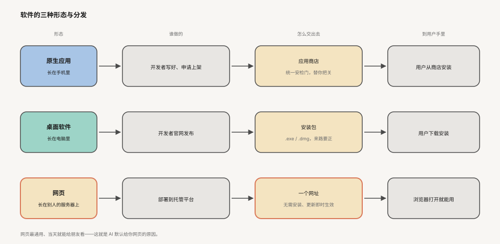

# 第 1 章 手机软件、桌面软件和网页，不是一回事

> 当 AI 默认递给你一个网页时，它其实替你做了一个重要的决定。你至少要知道，它替你决定了什么。

## 一、翻车现场

第一个场景。你对 AI 说：「帮我做个 App，给协会的朋友报名用。」AI 给了你一个网址。你在手机上打开，顺手转发到群里。马上有人问：为什么没有图标？得从浏览器进吗？能上架应用商店吗？你一个都答不上来。

第二个场景。另一位朋友请你「做个程序装到我电脑上」。你从 AI 那里拿到一个后缀是 .exe 的文件发给对方，对方双击时，屏幕弹出通红的警告框，吓得直接关掉。你不知道对方刚躲开的是危险，还是误会。

两个场景撞在同一堵墙上：软件不是一种东西。手机软件、电脑软件、网页，是三种不同的物种，住在不同的地方，用不同的方式交到别人手里。AI 造的是哪一种，决定了你接下来所有的问题。

## 二、为什么会这样

### 软件的三种形态

原生应用：安装在手机里的 App，比如微信、支付宝。它的本质是一个安装包，通过应用商店这条「安检通道」送到每个人的手机里。它贴近硬件，能拍照、能推送通知、能离线用；代价是上架要审核，每次更新也要走一遍商店。

桌面软件：装在电脑里的程序，交付物是一个安装包，Windows 上常见 .exe，苹果电脑上是 .dmg。它没有全网统一的安检门，官网直接发安装包是常态，所以系统见到来路不明的安装包会拉响警报。那是保护，不是刁难。

网页：不用安装，打开浏览器输入网址就能用。它不住在你的设备里，而是住在另一台电脑（行话叫服务器）上，你的浏览器每次都去那台电脑取最新的一页。更新即时生效，手机电脑通用；代价是依赖网络，能力被浏览器这个框框约束着。

这三个类别不是谁规定的，是「程序到底跑在哪里」这一个问题的三种答案：跑在你的手机里、跑在你的电脑里、跑在别人的服务器上。跑在哪里，决定了谁能用它、怎么更新它、怎么把它交到别人手里——后面所有的区别都是从这一个岔路口长出来的。

### 「分发」究竟是什么

你把软件「给别人用」，这个动作的正式名字叫分发。拆开看永远是两步：把程序的拷贝送到对方的设备上，再让对方设备允许它运行。三种形态的区别，就是这两步的填法不同。

网页把两步都省了——对方设备上跑的其实不是你的程序本身，而是浏览器代跑的一个副本。原生应用把两步都做足——安装包落进设备，商店替你完成「信任」这一步。理解了这两步，你就理解了后面几乎所有的问题：为什么有的东西打不开，为什么有的东西装不上，为什么有的更新立刻生效、有的要等。

「为什么有些软件需要安装」也在这两步里有了答案：安装，就是替对方完成「送拷贝 + 放行」这两个动作的仪式。程序需要长在设备上（离线用、调用硬件、不依赖网络），就绕不开安装；程序可以住在服务器上让浏览器代跑，就不需要安装。一个软件要不要安装，先问它跑在哪里。

### 为什么 AI 默认给你网页

因为网页最通用：手机电脑都能开，改完立刻生效，不需要任何人审核。对你——一个没有开发者账号、不打算走审核流程的人——这是唯一当天就能给朋友看到的形态。AI 的默认不是偷懒，是替你选了阻力最小的路。你只需要知道：它选的这条路，意味着什么。

## 三、怎么办

先回答三个问题，再决定要什么形态。用户在什么设备上用它？需要离线或硬件能力吗，比如拍照、推送、扫码？你希望今天就能用，还是可以等一周走审核？三个答案指向哪种形态，就是哪种形态。

网页长得像 App 是正常的。现在的主流网页在手机上打开时，本来就会收起地址栏、满屏显示，看起来和 App 几乎一样。行话叫响应式，意思是同一页内容，屏幕大小不同就换一副排版。不用纠结「这是不是真的 App」，问自己：用起来顺不顺手。

安装包的两条纪律。第一，只从官方商店或软件官网下载，别从搜索结果里的第三方下载站拿。第二，系统弹安全警告时，先看来源再放行：来源是你主动去找的官方渠道，可以继续；来源是一封邮件或一个群文件，关掉。

别急着上应用商店。手机应用商店上架需要开发者账号，年年收费，还有审核周期。等你确定这个东西值得长期维护，再考虑上架不迟，第 22 章会讲怎么判断。

想让朋友拿到的是安装包，不是网址。先把结论说在前面：多数场景坚持网页，因为网页替朋友省掉了「送拷贝」和「信任」两步，你也不用操心他的操作系统是什么。确有桌面交付的需求（必须离线用、深度调用硬件），直接对 AI 说：「把它打包成 Windows 上双击就能安装的安装包」——打包是 AI 的活，你要操心的是发出去的方式：用网盘链接或 GitHub 的 Releases 页面分发，别走群文件直传（容易被安全软件拦）。角色此刻互换：本章前面那条「安装包的两条纪律」，接收方变成了你的朋友——提前告诉他「这是我打包的，弹警告点是正常的」，是发放方的责任。

## 四、带走的问题

- 我要做的这个东西，用户会在什么设备上打开？
- AI 给我的形态（网页还是安装包），和我的用户匹配吗？
- 我把网址发出去时，对方不需要安装任何东西就能用吗？
- 这个安装包是从官方渠道来的吗？
- 我发安装包时，渠道选对了吗？有没有提前告诉朋友会弹安全警告？
- 我需要的到底是「看起来像 App」，还是「真的能用」？

本章顺便获得的概念：原生应用、桌面软件、网页应用、服务器、应用商店、分发、安装包、响应式。
