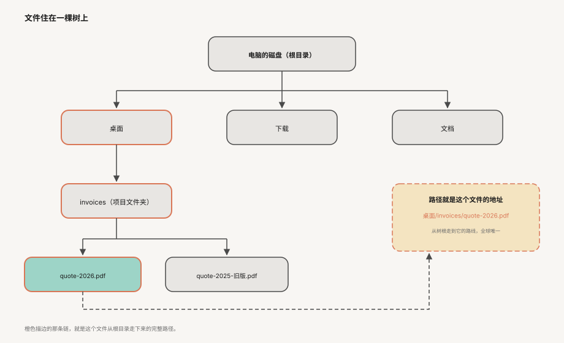

# 第 2 章 你的东西住在哪里：文件与文件夹

> 所有软件问题，追到最底下都是一个问题：它是一个文件，文件在文件夹里，文件夹在某个磁盘上。

## 一、翻车现场

AI 说：「把配置文件放到项目目录下。」你盯着这句话发呆——项目目录是什么？在哪？AI 说：「先下载这个文件。」下载完了，你找不到它去哪了。你的桌面上堆着「新建文档」「最终版」「最终版 2」「打死不改版」，三个月后你自己都认不出哪个是哪个。

还有更疼的：文件名里带了一个冒号或者问号，换台设备或者发给别人，文件直接打不开；或者手一抖，用同名文件把辛苦改了一下午的版本覆盖保存了，连后悔药都没有。

这些都不是笨，是没人讲过基本盘。这一章补的就是基本盘。

## 二、为什么会这样

### 文件系统就是一棵树

你的电脑里所有东西都是文件：文档是文件，照片是文件，程序本身也是一堆文件。文件装在文件夹里，文件夹装在更大的文件夹里，一层套一层，最顶上叫根目录——所以整个结构是一棵倒着长的树。

树结构带来一个推论：每个文件都有唯一的地址，行话叫路径。比如 `桌面/invoices/quote-2026.pdf`，就是从树根走到那个文件的路线。AI 跟你说「放到项目目录」，意思是放到某一个特定文件夹里——文件夹是约定好的家，放错家，程序就找不到它的东西。

顺带解开一个经典困惑：为什么 Windows 电脑有 C 盘，Mac 上却没有。Windows 以存储设备为中心，每个盘是一座孤岛，路径写的是物理位置；Mac 和 Linux 的整个系统只有一棵树，所有磁盘都挂在这棵树上，路径写的是逻辑位置。对你的实际影响只有一条：找东西和做备份时，别想「在哪个盘」，想「在那棵树的哪根枝上」。

### 扩展名是类型的标签

文件名最后那个点后面的部分，比如 .pdf、.png、.exe，叫扩展名，作用是告诉系统「我是哪种文件，该用什么程序打开」。它不是装饰，是标签。改掉扩展名不改变文件内容，但会让系统认不出它；反过来，有些坏东西会把危险的安装包伪装成图片，就看扩展名。

### 「删除」和「覆盖」比你想的更彻底

普通人的直觉是东西删了还能找回来，就像把纸扔进纸篓。部分成立：删除通常先进废纸篓。但覆盖保存不一样——同名新文件直接压在旧文件上面，旧的那份当场消失，不经过任何纸篓。第 11 章会给你真正的后悔药（版本控制），但在那之前，「另存为」就是普通人唯一的后悔药。

## 三、怎么办

找文件，用搜索，不要用眼睛。电脑自带的聚焦搜索（苹果）或 Everything 这类工具（Windows），输入文件名里任何一个词，几秒出结果。你的时间应该花在做事上，不是翻文件夹上。

文件命名三条铁律。第一，语义化：写清楚这是什么，比如 `2026-11-报名表-v3` 胜过「新建文档」。第二，日期用年-月-日开头：这样文件按名字排序就是按时间排序。第三，文件名里不用斜杠、冒号、问号、星号这些符号——它们在系统里有特殊含义，是保留字，不是装饰，用了轻则报错，重则文件在不同设备之间失联。

开工前先建家。让 AI 造东西之前，自己先建一个空文件夹，命名清楚，告诉 AI「所有东西都放这里」。一个项目一个家，所有文件——代码、配置、说明——都住在里面。以后搬家、备份、删掉重来，动一个文件夹就够了。

顺手学会另存为。改重要文件之前，先「另存为」一份带日期的新名字再动手。土，但有效，它是你在学会版本控制之前唯一的撤销键。

## 四、带走的问题

- 我的这个项目，家在哪个文件夹里？
- 这个文件的名字，三个月后的我能看懂吗？
- 我要动它之前，有没有先留一份旧版本？
- AI 让我放的「那个目录」，我知道确切位置吗？
- 下载的东西，默认落在哪个文件夹？

本章顺便获得的概念：文件、文件夹、文件系统、根目录、路径、扩展名。
