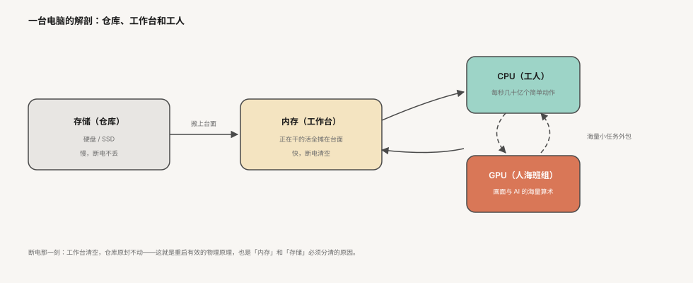

# 第 2 章 机器的解剖：比特、CPU、内存与硬盘

> 你不需要会修机器，只需要知道里面住着几位工人、各自管什么——排错和买电脑的判断力都从这里来。

## 一、翻车现场

AI 排错时问你：「确认一下内存够不够。」你愣住了——内存？它说的会不会其实是「存储空间不足」？这两个词你一直混着用，反正都是「电脑满了」。

买电脑的时候，参数表写着 8GB 内存、256GB 存储、几核 CPU，每个字都认识，连起来完全不懂。导购说「这个带独立显卡，跑 AI 快」，你点头，心里毫无概念。

还有那个经典的玄学：电脑越用越卡，重启立刻丝滑。没人给你讲过为什么，你也懒得深究——直到 AI 造的东西也卡了，你需要判断「卡在我这边还是它那边」。

## 二、为什么会这样

### 一切都是开关：比特与字节

计算机的全部世界里只有两种状态：开和关，记作 1 和 0。一个开关叫比特，八个比特捆成一组叫字节。你看到的一切——文字、照片、音乐、AI 的回答——本质上都是天文数字个开关的组合。所谓「数字化」，就是把这个世界的某个东西翻译成开关序列。

这个视角能解开一类困惑：为什么计算机如此较真（第 5 章），因为它只认识开关，不懂弦外之音；为什么文件能被精确复制，因为开关序列一模一样才是复制。

### CPU：一个快到不真实的简单工人

CPU 是干活的工人，但它只会极少数简单动作：读一个数、加一下、比大小、把结果搬走。它厉害的地方不在聪明，在快——每秒几十亿个动作。你所有的软件，最终都被翻译成这些简单动作的流水账，快到肉眼以为它「会思考」。

行话里的几核，意思是几个工人同时干活；主频，意思是每个工人多快。核多活多（同时开很多程序、很多浏览器标签），频快活利索（单个任务反应快）。AI 造东西的人不需要买顶级配置，但需要看懂这两个词在说什么。

### 内存与硬盘：工作台和仓库

内存是工作台：大、极快、正在干的活全摊在台面上，断电就清空。硬盘（存储）是仓库：慢、断电后东西原封不动。程序运行时，管家（第 7 章）把仓库里的文件搬到台面上干活。

「内存不足」是台面摆满了——程序互相挤，表现是卡；「存储不足」是仓库堆满了——新东西装不进来，表现是报错。两种「满」的解法完全不同：前者关程序或重启，后者删文件或扩容。AI 模型的文件动辄几个 GB，运行时整个搬上台面——这就是为什么 AI 应用吃内存。

### GPU：AI 时代的汽油

GPU 是一群只会做同一种简单算术的工人，单独看不强，胜在成千上万人海战术。画面渲染和 AI 计算，恰好都是「海量同款小任务」——所以 GPU 既是打游戏的心脏，也是 AI 的心脏。你按 token 付的算力费（第 16 章），买的本质是租 GPU 的时间。

## 三、怎么办

分辨两种「满」。卡：关掉吃资源的程序、重启；装不下：删旧文件、清缓存、扩容。AI 排错时把现象对号：「打开就慢」多半是台面，「保存失败」多半是仓库。

重启为什么有效，现在你可以说出原理了：清空工作台、把挤在一起的程序请走、让管家重新排班。它不是玄学，是物理。同时记住它的边界：重启解决「台面乱」，解决不了「仓库坏」和网络那头的问题——重启后还坏，说明要往别的方向查。

买电脑的四件套口诀：内存看台面（同时干多少活）、CPU 看手速（单个任务多快）、存储看仓库（装多少东西）、GPU 看外包班组（跑 AI、剪视频、打游戏才关键）。给 AI 造东西的人，内存和存储优先。

## 四、带走的问题

- 内存和存储的区别，我能一句话讲给别人听吗？
- 这次卡顿，是台面满了还是仓库满了？
- 重启解决不了的问题，说明问题不在台面——下一步往哪查？
- 我付的 AI 费用里，哪一部分是 GPU 的时间？
- 买下一台电脑时，四个参数我知道优先看什么了吗？

本章顺便获得的概念：比特、字节、CPU、内存、存储、GPU、重启。
