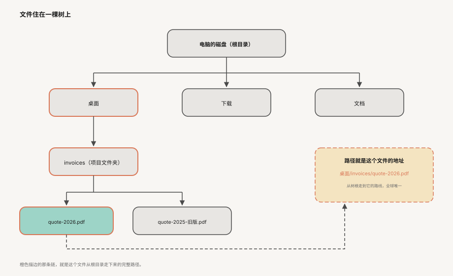

# 第 3 章 文件系统、路径与项目结构

> 理解文件的寻址、元数据与生命周期，才能准确管理项目及其配置。

## 一、文件系统

文件系统（File System）规定存储设备上的数据如何组织、命名和访问。普通文件可以作为字节序列读取；目录（Directory）组织名称与文件之间的关联。文件还具有权限、时间戳等元数据（Metadata）。

常见文件系统包括 NTFS、APFS 和 ext4。它们在大小写敏感性、权限、链接、快照等方面存在差异。操作系统也可以提供虚拟文件系统和网络文件系统，并非所有文件都对应物理磁盘中的一段普通数据。

## 二、绝对路径与相对路径

路径（Path）用于定位文件系统中的对象。绝对路径（Absolute Path）从相应根位置开始；相对路径（Relative Path）通常从当前工作目录（Current Working Directory，CWD）开始解析。

| 类型 | 示例 |
|---|---|
| Windows 绝对路径 | C:\Users\alice\project\README.md |
| macOS 或 Linux 绝对路径 | /home/alice/project/README.md |
| 相对路径 | config/settings.json |
| 当前目录 | . |
| 上级目录 | .. |

Windows 支持卷盘符、挂载点及 UNC 网络路径；类 Unix 系统通常将多个文件系统挂载到统一目录层级。路径是逻辑名称，不必对应固定的物理设备。

符号链接（Symbolic Link）可以引用其他路径，硬链接（Hard Link）可以使多个名称引用同一文件对象。因此，一个文件不一定只有一个路径。复制或删除链接与操作目标文件也不是同一回事。



## 三、扩展名、内容与权限

扩展名（Filename Extension）是文件名的一部分，常用于关联应用和识别预期格式。真实格式由内容及格式规范决定。例如将 PNG 文件改名为 .jpg 不会完成图像编码转换。

访问权限（Permission）决定主体能否读取、写入或执行文件。路径存在不代表当前用户有访问权限。错误消息中的 File Not Found 与 Permission Denied 应分别处理。

## 四、项目结构与配置

一个示例项目可以包含：

```text
project/
  README.md
  src/
  tests/
  config/
  .gitignore
  dist/
```

src 保存源代码，tests 保存测试，config 保存配置，dist 常用于构建产物。这些是惯例而非强制标准。README 应说明启动方法、依赖、配置和构建目录。

项目根目录是项目约定的起始位置，不一定等于 Shell 当前目录。运行命令之前应确认二者关系。不要硬编码开发者个人的绝对路径；需要跨平台的程序应使用适当的路径处理接口。

配置文件描述软件行为，密钥则属于敏感凭据。不能因为文件位于项目目录就认为它适合提交版本控制，第 15 章将解释管理方法。

## 五、删除、覆盖与恢复

删除文件可能进入系统回收站，也可能直接移除目录关联。命令行工具、网络文件系统和应用程序行为不一定相同。覆盖保存可能原地修改文件，也可能以新文件替换旧文件。

恢复能力取决于备份、版本控制、快照及存储实现，不能依赖回收站。同步服务也可能传播错误删除。第 17 章与第 18 章分别讨论备份与版本管理。

## 六、实践：观察路径解析

创建一个仅用于练习的 fundamentals-lab 目录，在其中创建 note.txt 和子目录 data。使用文件管理器确认绝对路径，再在终端进入该目录。

macOS 或 Linux 可运行 pwd 和 ls；PowerShell 可运行 Get-Location 和 Get-ChildItem。进入 data 后比较当前目录与上级目录，并观察相同相对路径在不同工作目录下的解析结果。

## 七、与 Agent 协作

请先确认仓库根目录和当前工作目录，列出配置文件、源码、测试及构建产物的位置。使用相对路径或平台路径 API，检查 Windows 与 Linux 的路径兼容性。未经授权不要覆盖原始数据、跟随未知符号链接或删除目录。

## 八、知识检验

- 相对路径为什么可能在另一目录运行失败？
- 扩展名能否证明文件真实类型？
- 文件存在为什么可能无法打开？
- Git 与备份是否能恢复所有未跟踪文件？

进阶方向：挂载点、inode、文件描述符、ACL、原子替换与文件锁。
