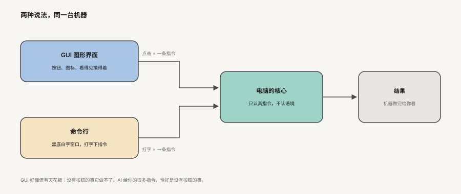

# 第 4 章 黑底白字的窗口：GUI 与命令行

> 命令行不是黑客工具，只是另一扇跟电脑说话的窗户。你会用鼠标，就一定会用键盘跟它说话。

## 一、翻车现场

AI 做完东西，最后跟你说：「在终端里运行 npm install，然后 npm run dev。」你找到这个叫「终端」的程序，打开，一片黑，光标一闪一闪，像在等你说暗号。你把那行字敲进去，回车，屏幕哗哗滚出一堆英文，有红有白。你不知道这是成功了还是在骂你。

另一个常见现场：你把那条命令复制下来，粘回 AI 的对话框里，问「这是什么意思」。AI 老老实实解释了半天——但你的东西还停在原地没跑起来。

这两个现场的共同点：你和电脑之间隔着一层你从没意识到存在的翻译层。

## 二、为什么会这样

### 你熟悉的电脑，是一层翻译

平时你用电脑，点点图标、按按按钮，这种「看得见、摸得着」的操作方式叫 GUI，图形用户界面，就是把机器的语言翻译成人能看的图。你的每一次点击，翻译到底层都是一条明确的指令。

GUI 好懂，但有天花板：它只提供开发者做出来的按钮。没有按钮的事，GUI 就做不了。而 AI 给你的很多指令——安装依赖、启动程序、部署上线——恰恰是没有按钮的事。

### 命令行：跳过翻译，直接说话

命令行就是跳过图，直接用打字跟电脑说话的方式。那个黑底白字的窗口叫终端，你敲进去的一行字叫命令，每个命令是一个明确的动作：安装、列出、移动、删除。

开发者偏爱它有三个原因，对你也成立。第一，精确：一条命令写清楚，不会点错地方。第二，可复制：命令是文字，能发消息、能进文档、能贴给 AI——这就是为什么 AI 总给你命令而不是给你画路径图。第三，可重复：同一条命令明天再敲一遍，结果一样。

黑底白字不等于危险。它危险与否，取决于里面跑的那行字是什么，就像刀危险与否取决于谁拿、往哪切。

### 那些红色文字，多数不是骂你

终端输出哗哗滚动的白字，是正常的工作汇报。红色文字有两种：一种是报错，一种是进度提示（有些工具用红色写「正在下载」）。判断办法很简单：把最后一行复制给 AI，问「这是报错吗」。永远不要自己对着满屏英文吓自己。

## 三、怎么办

找到你的终端。苹果电脑：按 Command 加空格，输入「终端」，回车。Windows：点击开始菜单，输入 PowerShell 或「终端」，回车。记住这个打开方式，你接下来和 AI 协作的一切都从这里开始。

你只需要会五个动作：打开终端、粘贴命令、回车、看最后一行输出、把输出复制走。就这五个，没有第六个。AI 让你运行什么，你粘贴、回车、把结果原样带回来给它——你就是 AI 的手，AI 是你的嘴，这个配合方式会贯穿全书。

粘贴陌生命令前的三秒检查。看动词：命令里有没有删除类的词，Linux 和苹果上常见的 rm、Windows 上的 del 或 Remove-Item，有的话先问 AI「这条会删什么」。看权限：命令以 sudo 开头（苹果、Linux）或者运行后弹出要管理员密码的框，意味着它要动系统级的东西，确认这是你主动要做的。看来源：命令是 AI 给你的，还是群聊里陌生人发的？前者可以查证后执行，后者直接不理。

 sudo 和管理员权限意味着什么？系统把「可能影响整机安全」的操作单独设了一道闸，需要你额外确认。闸是对的。习惯是：不是你主动发起的操作要密码，一律不给。

把输出完整带回来。求 AI 排错时，贴「最后 20 行左右」而不是只贴一行，更不要自己转述「大概是说少了什么东西」。转述丢掉的信息，常常正是答案所在。

## 四、带走的问题

- 我的终端在哪里，怎么打开？
- 这条命令里有没有删除类的词？
- 它要不要管理员密码？为什么需要？
- 输出的最后一行说了什么？我能原样复制给 AI 吗？
- 这条命令是我主动要的，还是别人塞给我的？

本章顺便获得的概念：GUI、命令行、终端、命令、输出、管理员权限、sudo。
