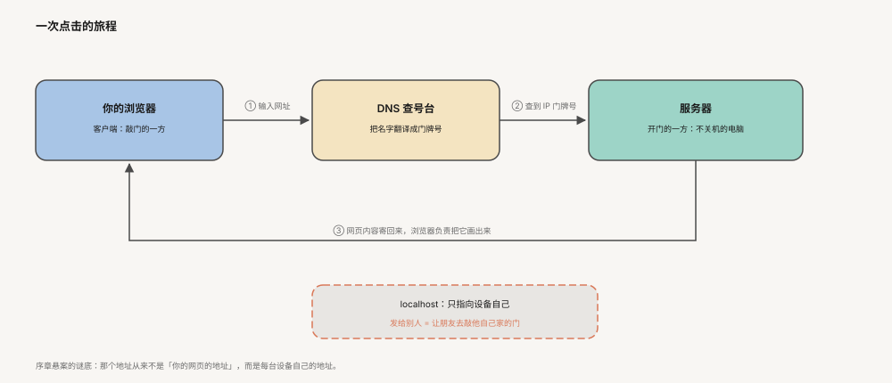

# 第 5 章 一次点击的旅程：网络是什么

> 序章那扇打不开的门，谜底在这一章。你不需要懂协议，只需要记住一张地图：谁在敲门，谁住在门后。

## 一、翻车现场

先把序章的案子结了。我太太把 localhost 开头的网址发给朋友，朋友打不开——因为那个网址的意思是「这台电脑自己」，它压根不是一个能发给别人的地址。这个案子第 6 章会给出完整的解法，但谜底先在这里揭开。

第二个场景。你做的网页昨天还好好的，今天打开是一片空白。你问 AI，AI 回了一堆，你越看越乱。「网站挂了」这四个字，你天天听说，但从没人给你拆开讲过：挂的是什么？

网络是全书所有问题的公共底座。这一章只讲一张地图，但值得多花点心思。

## 二、为什么会这样

### 客户端和服务器：敲门的和开门的

每一次你在浏览器里打开一个网页，背后都发生同一件事：你的设备（行话叫客户端）向另一台电脑（行话叫服务器）发出请求，服务器把网页内容寄回来，你的浏览器把它画出来。你看到的一切网页，都是这个「敲门—开门—寄包裹」的过程。

服务器不是什么神秘的东西，就是一台不关机、专门负责应答的电脑。它可能在美国的数据中心，也可能就坐在你对面的桌子底下。你用 AI 造的东西将来也住进某台服务器——那就是「上线」两个字的本义。

### IP、域名和 DNS：门牌、名字和查号台

每台联网的电脑都有一个门牌号，叫 IP 地址，长这样：142.250.71.14。机器认门牌号没问题，人不认——你记不住几万个门牌号。所以有了域名（比如 google.com，好记的名字）和 DNS（一个遍布世界的查号台，负责把名字翻译成门牌号）。

你在浏览器输入网址后发生的事：先去查号台查这个名字对应的门牌号，再按门牌号去敲门。理解了这条链，你就理解了一大类故障：查号台被劫持、门牌号变了、门牌号对应的服务器没开机——任何一个环节断掉，表现都是「打不开」。

### localhost：自言自语的门牌号

localhost 是一个特殊的名字，翻译过来是「本机」。它的门牌号指向设备自己。你在自己电脑上访问 localhost，敲的是自己家的门，AI 写的程序就住在里面，所以你这边一切正常。朋友在他的设备上访问同一个地址，敲的是他自己家的门——他家门后什么都没有。

这就是序章悬案的全部谜底：那个地址从来不是「你的网页的地址」，而是「每台设备自己的地址」。你要给朋友的，是一个全世界都能查到门牌号、门后住着你的程序的名字。这件事怎么做到，第 6 章讲。

### HTTPS：明信片和密封信

网址开头有两种：http 和 https。区别一句话：前者是寄明信片，沿途谁都能看内容；后者是寄密封信，只有收件人能拆。网址旁边那把小锁，意思是这封信是密封的。现在正经网站都用密封信，浏览器对用明信片的网站会标注「不安全」。你上线自己的东西时，这也是一条硬标准。

## 三、怎么办

「打不开」的三个自查，按顺序做。第一，只有我打不开，还是所有人都打不开？用手机流量（关掉 Wi-Fi）再开一次，两种网络结果不同，问题多半在本地网络。第二，最近是不是改过什么、动过什么？第三，是不是钱或者额度的问题——托管服务欠费、免费额度用完，服务器会直接闭门谢客。

「网站挂了」通常是三种死法之一：服务器那台电脑没电了或出故障了；服务器活着但上面你的程序死了；服务器和程序都活着，但网络路断了。你不需要会修，只需要在求助 AI 时说清现象，让它帮你定位是哪一种。

向 AI 描述网络问题的模板：「我的网址是什么，我在什么设备什么网络下访问，看到什么现象（空白/报错文字/转圈超时），什么时候开始这样的，最近做过什么改动。」现象说得越具体，定位越快。

顺带一个生活常识：同一 Wi-Fi 下家人的设备全断了，多半是路由器问题，重启路由器能解决世界上百分之几十的网络玄学——这条和 AI 无关，但能救命。

## 四、带走的问题

- 我访问一个网址时，是谁在敲门、谁住在门后？
- localhost 指向哪台设备？
- 我的域名是什么？它现在指向哪个门牌号？
- 我的网址开头是 http 还是 https？
- 「打不开」的时候，我先做了哪三个自查？

本章顺便获得的概念：客户端、服务器、IP 地址、域名、DNS、localhost、HTTPS、明信片与密封信。
