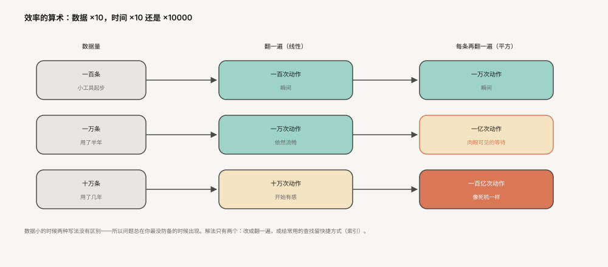

# 第 6 章 效率与瓶颈：为什么程序会变慢

> 机器每秒做几十亿次动作，但「次数」会让快变成慢。效率不是玄学，是一道乘法算术题。

## 一、翻车现场

报名工具上线那天秒开，朋友们都说好用。半年后记录涨到了几百条，列表开始转圈；涨到几千条，要等五六秒才出内容。你没改过任何东西——只是数据在长大。

另一个现场：家庭账单从记一个月到记了三年，图表页面拖拖拽拽卡成了幻灯片。你问 AI「能不能优化一下」，它回了一大段你看不懂的词，改完有时快了，有时没快，还有一次把功能改坏了。

## 二、为什么会这样

### 机器很快，但次数会爆炸

第 2 章说过，CPU 每秒做几十亿次简单动作，单次动作快到无法感知。效率问题的根源不在单次快慢，在**次数**：一个「把所有记录翻一遍找出符合条件的」动作，一百条数据就是一百次，一万条就是一万次，十万条就是十万次。单次百万分之一秒，乘上十万次，就是肉眼可见的几秒等待。数据小的时候哪种写法都快，数据一大，次数的差距才拉开——所以这个问题总在你最没防备的时候出现。

### 次数的算术：三种典型

把工程师的效率世界压缩成三句话。**翻一遍**：数据翻十倍，时间翻十倍——正常，多数程序这样。**每条再翻一遍**：处理每条数据时，又把全部数据翻一遍——数据翻十倍，时间翻一百倍，指数级恶化，这是 AI 写的代码里最常见的事故。**留了快捷方式**：给常用的查找建一个直达通道（工程师叫它索引），不管多少数据，几次动作直达——这是标准解法。

### 瓶颈通常只有一个

变慢的程序里，九成的等待来自同一处：重复次数最多的那个动作。工程师的说法叫找到瓶颈。对普通人的推论很实际：别对 AI 说「帮我优化一下」（它可能到处小修小补），要问对那一个地方。

## 三、怎么办

变慢时的三个问题，按顺序问。第一，数据涨了多少？记录从一百涨到一万，变慢几乎必然是次数的算术，不是机器坏了也不是 AI 退步了。第二，把现象和数据量一起告诉 AI：「三千条记录时列表要五秒，如果涨到三万条会不会更糟？现在的写法是不是每次都在翻全部数据？」——让 AI 替你算次数。第三，只要两个具体方案：「改成翻一遍就能出结果的写法」「给常用的查找留快捷方式（索引）」，一次一个，改完用真实数据量验收。

预防只要一句话：数据会长大。造工具时多问 AI 一句「数据涨到一万条时它会变慢吗」——一句话的成本，免掉半年后的卡顿和一轮危险的大改。

什么时候不用管：几十条数据的工具，怎么写都快；为它提前优化，是把钱花在用不上的地方——和第 16 章的成本思维是同一件事：先有真实的量，再谈优化的投入。

## 四、带走的问题

- 它变慢，是在数据长大之后吗？涨了多少倍？
- 现在这个动作，数据翻十倍时时间会翻十倍还是一百倍？
- 我问过 AI「数据到一万条会怎样」吗？
- 瓶颈找到了吗，还是在对的地方之外乱改？
- 这个工具的数据量，配得上为它操心效率吗？

本章顺便获得的概念：效率、次数、瓶颈、线性、索引。
