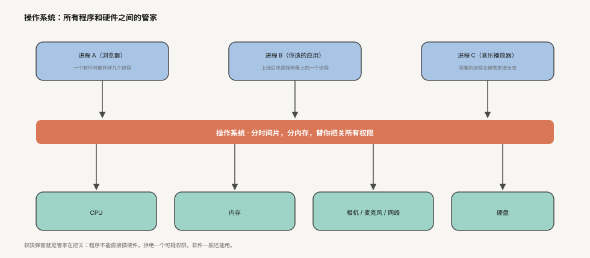

# 第 7 章 操作系统：住在电脑里的管家

> 你从来没直接操作过 CPU 和内存——所有请求都经过一位管家。读懂管家，就读懂了电脑一半的脾气。

## 一、翻车现场

装了一个新软件之后，整台电脑都变慢了——明明你只开了它一个。某个程序转着圈死掉了，你发现其他程序也跟着遭殃。屏幕弹出「此应用想访问你的相机」，你不记得自己请求过任何东西。

另一个现场：听说服务器上跑的都是 Linux，可你从来没在任何服务器上见过它的影子。AI 的机房里也全是它。一个你从未见过的系统，统治着你看不见的世界。

## 二、为什么会这样

### 管家的三件差事

操作系统（苹果的 macOS、Windows 电脑的 Windows、服务器的 Linux）是所有程序和硬件之间的管家。它的差事有三件：分时间——几十个程序抢一个 CPU，管家排班，每个轮一小段，轮换快到像同时进行；分台面——给每个程序划一块内存，不许越界（第 2 章的工作台）；管硬件——相机、键盘、网络、硬盘，所有硬件都由管家统一调度。

「所有程序不能直接摸硬件」是整台电脑最重要的一条规矩。它带来两个后果：程序之间互相隔离（一个崩了不掀桌子）；硬件权限可以被管家把关——所以会有权限弹窗，那是管家在替你把门。

### 进程：程序活着的样子

程序是躺在仓库（硬盘）里的一堆文件；进程是管家把它叫起来、摆上工作台干活的样子。一个软件可以同时开好几个进程——浏览器每个标签页一个，出事时你能定位到具体哪一个。程序删除了进程自然消失；进程崩了，程序文件还在仓库里毫发无损。

你用 AI 造的东西，上线后也以进程的方式活在服务器上（第 13 章）。「我的程序死了」的准确含义是：那个进程没了，得重新叫起来。

### 为什么一个程序卡，全家都卡

卡的本质是管家排不开班：某个进程吃光了 CPU 时间片，或者把台面（内存）占满，别的进程挤在门外。强制退出，就是请管家把闹事的工人请出去——注意，它没保存的工作会丢，所以退之前先想想有没有要保存的东西。

这也是重启有效（第 2 章）的管家视角：把所有进程清场，台面归零，重新排班。

### Linux：看不见的普通话

你服务器上的程序、各大网站、AI 的训练机房，绝大多数跑在 Linux 上。你没见过它，因为服务器通常没有屏幕——它只通过命令行和网络跟世界对话（第 4 章的终端就是它的日常）。你用托管平台部署（第 13 章）时，Linux 的部分平台全替你管了；但知道「我的东西跑在 Linux 上」，读文档和排错时会少很多困惑。

## 三、怎么办

看谁在吃资源。苹果电脑打开活动监视器，Windows 打开任务管理器（找法同第 4 章的终端：搜索名字即可）。按 CPU 或内存排个序，最上面那个就是当下最忙的工人——卡的时候先看它。

强制退出要付的代价。先保存正在用的东西，再退出闹事的进程；找不到保存键就截图现场，退出后照着恢复。

权限弹窗的三秒检查，把第 4 章的三问搬过来：是不是我主动发起的动作？这个权限合理吗——计算器要相机、输入法要定位，都可疑？不合理的直接拒绝，软件一般还能用。

排错的第一站。你自己造的东西卡了打不开了，先开进程清单看一眼：它还在不在跑？在跑但没反应，和根本不在，是两种完全不同的病——第 14 章的排错会用到这个分叉。

## 四、带走的问题

- 我的电脑管家叫什么名字？资源监视工具在哪里？
- 进程和程序的区别，我能举出一个例子吗？
- 最近一次权限弹窗，我要的权限合理吗？
- 我造的东西上线后，它是一个进程吗？死了怎么重新叫起来？
- 服务器上的 Linux，我需要在什么场合面对它？

本章顺便获得的概念：操作系统、进程、时间片、权限、Linux。
