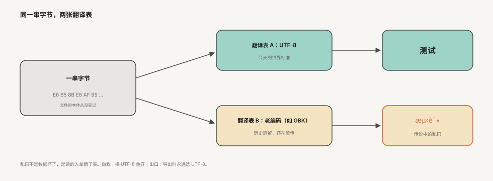

# 第 8 章 数据的样子：字节、编码与格式

> 乱码、发虚的图片、打不开的文件——全是「拿错翻译表」和「用错画法」这两个根。

## 一、翻车现场

导出的账单 CSV 打开是一屏乱码，中文全变成了「测试」这种天书。从网页复制的文字粘进文档，排版全飞。把 logo 的 JPG 放大两倍，边缘糊成了马赛克。

更日常的：同一个文件在 Mac 和 Windows 上表现不一样；给 AI 喂数据，它说「请提供 CSV 或 JSON 格式」——你知道这两个词是文件，但不知道为什么偏偏是它们。

## 二、为什么会这样

### 文件就是一串字节，格式是读它的约定

第 2 章说过，一切都是字节。一份文件的本质是「按顺序排好的字节串」，而格式（扩展名，第 3 章）是读它的说明书：先读哪两个字节当宽度、接着多少字节当颜色。格式不对，字节还在但意义全错——就像把菜谱当成乐谱念，字都认识，内容全毁。「文件损坏打不开」很多时候其实是「读它的约定对不上」。

### 编码：字节到文字的翻译表

文字要变成字节，得先有一张翻译表——每个字对应哪串字节，这张表叫编码。世界曾有很多张表：中国大陆的 GBK、欧洲各表的 ISO 系列，同一串字节在不同表里读出不同文字。乱码的本质就是拿错表：用 A 表写的字节，拿 B 表去读。「测试」不是数据坏了，是读的人拿错了表。

今天的标准答案是 UTF-8，一张几乎覆盖全世界文字的表。你只需要记住：能用 UTF-8 就用 UTF-8；打开旧文件出现乱码，八成是老文件用了老表，换一张表重开（大多数软件的「打开方式」里都能选编码）。

### 位图与矢量：两种画法

照片类文件是位图：把画面切成百万个小方格（像素），每个格子记一个颜色。放大就是格子变大——糊了。图标、logo 类文件可以是矢量：它存的不是格子，是画法（「从这里画一条线到那里，圆角，红色」），放大一万倍都锐利——你配图用的 SVG 就是矢量（第 9 章的插图也是）。压缩是第三层：JPG 扔掉人眼不在意的细节换体积，代价是反复编辑后出现毛边；PNG 不扔细节所以更清晰也更大。

### CSV 和 JSON：给程序吃的两张表

CSV 是最朴素的表格：一行一条记录，逗号隔开列，任何程序都认——第 17 章搬家首选。JSON 是「填空题清单」：用花括号和引号描述「哪个字段是什么值」，嵌套起来能表达复杂结构，是程序之间递纸条的标准格式。AI 对这两种格式都驾轻就熟——给它喂结构化数据，认准这两个。

## 三、怎么办

乱码三秒自救。别急着重新导出：先用软件的「打开方式」换个编码（优先 UTF-8）重开一次，多数乱码当场痊愈。实在不行再回到源头重新导出，导出时编码选 UTF-8。

选格式的口诀。照片用 JPG（体积小够用）、要透明背景或多次编辑用 PNG、图标和几何图形用 SVG（无限放大不失真）、给程序吃的表格用 CSV、程序间的填空清单用 JSON。

喂 AI 数据的两条纪律。格式用 CSV 或 JSON，别发截图让 AI 识字（第 15 章讲过截图的纪律）；喂之前自己先用文本编辑器打开瞄一眼，确认没有敏感列——数据一出门就收不回来。

## 四、带走的问题

- 上一次乱码，是翻译表的问题还是文件真坏了？
- 我的 logo 存的是矢量还是位图？放大十倍会糊吗？
- 给 AI 或程序的数据，格式用对了吗？
- 这个文件如果换台设备打开，还会一样吗？
- 我导出的东西，编码是不是 UTF-8？

本章顺便获得的概念：字节、编码、UTF-8、位图、矢量、压缩、CSV、JSON。
