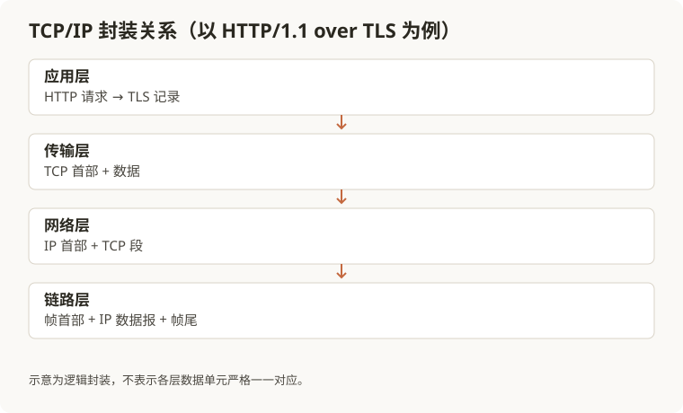

# 第 9 章 计算机网络：从地址到应用协议

> 理解一次网络请求的完整路径，才能区分地址、连接、协议和应用故障。

## 一、网络通信的基本模型

客户端（Client）发起服务请求，服务器（Server）提供服务。两者是通信角色，不是硬件分类。同一台计算机上的浏览器和 Web 服务进程也可以形成客户端与服务器的关系；一个后端服务还可以作为客户端访问数据库。

网络通信需要约定数据格式和交互规则，这类约定称为协议（Protocol）。互联网使用 TCP/IP 协议族。不同层次承担不同职责：

| 层次 | 常见协议 | 职责 |
|---|---|---|
| 应用层 | HTTP、DNS | 定义应用数据及交互方式 |
| 传输层 | TCP、UDP | 区分通信端点，提供进程间通信 |
| 网络层 | IPv4、IPv6 | 寻址与跨网络路由 |
| 链路层 | Ethernet、Wi-Fi | 在当前链路上传输数据 |

发送时，上层数据通常被封装进下层协议的数据单元；接收时逆向解析。路由器根据 IP 地址和路由表决定下一跳。协议分层使应用程序不必直接控制网卡，但链路、路由、传输和应用均可能发生故障。



## 二、IP 地址、端口和域名

IP 地址（Internet Protocol Address）用于网络层寻址，通常配置在网络接口上。一台设备可以有多个地址。IPv4 使用 32 位地址，IPv6 使用 128 位地址。常见的 IPv4 私有地址如 192.168.1.20，不能直接在公共互联网中路由。

端口（Port）是 TCP 或 UDP 首部中用于标识通信端点的 16 位编号。例如一个 Web 服务可以监听 TCP 8080，另一个监听 TCP 3000。操作系统根据协议、地址和端口将收到的数据交给相应的套接字（Socket）。

域名（Domain Name）是层级化名称。域名系统（Domain Name System，DNS）提供多种记录的查询功能；A 记录表示 IPv4 地址，AAAA 记录表示 IPv6 地址，CNAME 表示名称别名。域名不等于网站，也不一定只对应一个 IP 地址。解析结果可能来自缓存。

localhost 通常解析为回环地址（Loopback Address）127.0.0.1 或 ::1。发送到回环地址的数据由本机网络协议栈处理，而不需要经过外部网络。若服务只监听回环地址，其他设备不能直接连接该服务。监听 0.0.0.0 则通常表示接受所有本机 IPv4 接口上的连接；实际可达性仍受防火墙、路由和网络地址转换（NAT）限制。

因此，序章中的问题不是网页没有生成，而是访问地址和部署范围不符合分享需求。

## 三、TCP、UDP 与 TLS

传输控制协议（Transmission Control Protocol，TCP）提供可靠、有序的字节流。建立连接通常经过三次握手；数据丢失时可以重传，并通过流量控制和拥塞控制限制发送行为。TCP 不保留应用消息边界，应用协议需要自行定义消息格式。

用户数据报协议（User Datagram Protocol，UDP）传输独立的数据报，本身不保证送达、顺序或重传。实时媒体、DNS 等应用常使用 UDP。QUIC 在 UDP 之上实现可靠传输、安全连接等能力，HTTP/3 使用 QUIC。

传输层安全协议（Transport Layer Security，TLS）提供加密、完整性保护及对端认证。浏览器访问 HTTPS 时通常验证服务器证书与目标主机名，并协商会话密钥。HTTPS 是受到 TLS 等安全传输机制保护的 HTTP；它不能证明网站内容可信，也不能替代应用层的身份认证和权限控制。

## 四、HTTP 请求和响应

统一资源定位符（Uniform Resource Locator，URL）描述资源的位置与访问方式。例如：

```text
https://example.com:443/api/orders?id=123
```

其中 https 是方案（Scheme），example.com 是主机名（Host），443 是端口，/api/orders 是路径（Path），id=123 是查询字符串（Query）。

超文本传输协议（Hypertext Transfer Protocol，HTTP）定义请求与响应的语义。下面是一个简化的 HTTP/1.1 请求：

```http
GET /api/orders?id=123 HTTP/1.1
Host: example.com
Accept: application/json
```

GET 表示获取资源，Host 指明目标主机，Accept 表示期望的响应媒体类型。POST 常用于提交数据或触发处理；PUT、PATCH、DELETE 分别有不同的更新或删除语义。具体行为由应用接口定义，不能只看方法名就假定请求安全。

服务器可能返回：

```http
HTTP/1.1 200 OK
Content-Type: application/json

{"id":123,"status":"paid"}
```

状态码（Status Code）表示请求处理结果。200 表示成功，401 表示缺少有效认证凭据，403 表示拒绝请求，404 表示资源未找到或不愿披露，500 表示服务器内部错误，502 表示网关收到无效上游响应。HTTP/2 和 HTTP/3 使用不同的传输表示，但共享这些基本语义。

在没有可用缓存或已有连接的典型 HTTPS 请求中，浏览器解析 URL，查询 DNS，建立 TCP 连接并完成 TLS 握手（HTTP/1.1 或 HTTP/2），发送 HTTP 请求，接收并处理响应。实际系统可能复用连接、经过代理、CDN 或负载均衡器。

## 五、可复现实验：观察网络请求

打开浏览器开发者工具（Developer Tools）的 Network 面板，访问 https://example.com 并刷新。选择文档请求，观察 URL、请求方法、响应状态、响应头和 Timing。不同浏览器显示方式可能不同。

若已安装 curl，可在终端运行：

```sh
curl -v https://example.com/
```

观察解析地址、连接过程、TLS 信息和 HTTP 响应。不要将包含 Cookie、Authorization 或其他凭据的日志直接公开。

如果本机安装了 Python 3，在一个仅含测试文件的临时目录运行 python -m http.server 8000 --bind 127.0.0.1（部分系统使用 python3 或 py），再访问 http://127.0.0.1:8000。停止服务后重新访问，比较连接失败与 HTTP 404 的区别。实验结束按 Ctrl+C 停止服务。

## 六、与 Agent 协作：按层定位故障

当网站无法访问时，先区分 DNS 解析错误、连接拒绝、连接超时、证书验证失败、HTTP 错误和页面脚本异常。这些现象不能相互替代，也不一定直接说明根因。

可以这样提出任务：请在不修改生产环境的前提下，检查目标域名的 DNS 记录、目标端口的连接、TLS 证书有效性及 HTTP 状态码。若收到 502，检查反向代理日志与上游服务健康状态。列出每一步的证据、尚未确认的假设和建议的最小修复。日志中不得包含访问令牌。

## 七、知识检验与拓展

- 同一台设备为什么可以运行多个 Web 服务？IP 与端口分别承担什么职责？
- DNS 查询成功为什么不代表网站可用？
- HTTPS 为什么不能代替应用权限控制？
- HTTP 404 与 TCP 连接拒绝分别发生在哪个层次？
- 为什么把监听地址改为 0.0.0.0 仍不一定能从公网访问？

进一步阅读：RFC 9110（HTTP 语义）、RFC 9293（TCP）、RFC 8446（TLS 1.3）。本章为第 10 章云计算、第 13 章部署和第 14 章排错提供基础。
