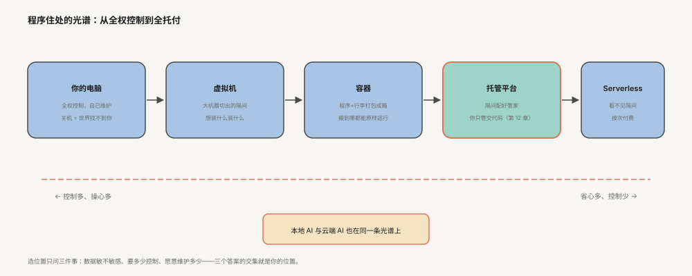

# 第 10 章 云的地图：程序住处的连续光谱

> 「云」不是天上的东西，是别人的电脑加一套自动化。从你自己的笔记本到无人机房，是一条连续的光谱。

## 一、翻车现场

朋友跟你炫耀「我的数据都在云上，绝对安全」，你不知道该放心还是警惕。有人聊起「我在本地跑了个模型」，另一人说「我们用 Serverless」，三个词把天聊死。你自己的东西还躺在免费托管平台（第 13 章）上，不知道要不要「上云」。

## 二、为什么会这样

### 云 = 别人的电脑 + 自动化

把「云」祛魅只需一句话：云就是别人帮你维护的、随开随用的电脑，外加一套自动化（坏了自动换、忙了自动加）。第 13 章的托管平台是最温和的一档云。它解决了真问题——不用买机器、不用管它死活、用多少付多少；也带来一个你早就熟悉的代价——东西长在别人的地基上（第 17 章的平台锁定）。

### 从笔记本到机房：一条连续的光谱

光谱的一端是你自己的电脑：全权控制，但停电关机全世界就找不到你。往外走是虚拟机——服务商把一台大机器切成很多隔间，你租一个，想装什么装什么，坏了服务商换一个给你。再往外是容器——更轻的隔间，行话叫集装箱：把程序和它的全部行李打成一个标准箱子，搬到哪都能原样运行。托管平台站在再外面：隔间配管家，你只管交代码。最远处是 Serverless——连隔间都看不见了，你的程序被拆成一个个函数，有人调用才运行，按次计费。

光谱越往外，越省心、越弹性、但控制越少；越往内，控制越多、越操心。没有正确答案，只有取舍。

### 「本地 AI」和「云端 AI」也在同一条光谱上

用 AI 的方式同样排成这条线：云端大模型（最强、按 token 付费、数据要出门，第 15 章）到本地小模型（在自己电脑里跑，数据不出门，能力弱一截，吃你的内存和 GPU——第 2 章）。第 12 章讲怎么选。

## 三、怎么办

选位置只问三个问题。数据敏不敏感：越敏感越往内（本地、自托管）；需要多少控制：越要定制越往内；愿意维护多少：越不想维护越往外。三个答案的交集就是你的位置——对本书的读者，答案通常落在托管平台这一格，已经够了。

读云宣传页自带一台翻译机。「弹性」= 忙时自动多开机器，闲时自动关掉省钱；「高可用」= 坏了自动换一台，你基本感知不到；「按量计费」= 用一次付一次，但超额自动扣款的那颗雷（第 16 章）也在「按量」里。翻译完再做决定。

一个清醒的提醒。光谱上的位置不是终身制：先从托管平台起步，等数据敏感度或用户量变化了再迁移——第 17 章的导出权就是你的迁移通行证。

## 四、带走的问题

- 我的东西现在住在这条光谱的哪一格？
- 我的数据敏不敏感？答案有没有让我想往内挪一格？
- 我愿意维护多少？诚实的答案是什么？
- 「本地跑 AI」这个选项，我的电脑配置撑得住吗（第 2 章）？
- 我读得懂云厂商宣传页里的那些词吗？

本章顺便获得的概念：云、虚拟机、容器、Serverless、自托管、本地模型。
