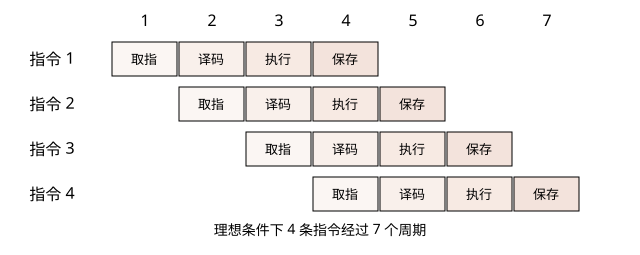

# CPU 怎样一步一步执行程序

上一章的四条指令可以计算 3 加 5，并保存结果。现在我们站在硬件的角度，看第一条指令到底怎样发生。

执行这些指令的硬件称为处理器（Processor）。中央处理器（Central Processing Unit，CPU）是计算机承担通用程序执行任务的核心部件之一。

## 处理器里面有什么

我们已经逐一认识了组成简单处理器所需的一些部件。

寄存器可以保存运算所需的数字；用于完成算术和逻辑操作的电路组合称为算术逻辑单元（Arithmetic Logic Unit，ALU）；程序计数器保存与指令位置相关的信息。还有负责根据指令组织这些部件工作的控制逻辑。

这些部件需要与保存指令和数据的存储器交换信息。

这张图只保留理解执行过程所需的部件，不代表现代 CPU 的完整内部结构。实际处理器可能拥有多个执行单元、缓存和复杂的内部互连。

## 取出、解释并完成一条指令

假设程序计数器指向第一条 LOAD 指令。处理器根据这个位置取得机器指令，这个动作称为取指（Instruction Fetch）。

取得的指令仍是一组二进制数据。控制逻辑根据指令编码确定操作种类和需要使用的部件，这叫译码（Instruction Decode）。

对于 LOAD R1, 100 这一教学指令，接下来需要取得地址 100 中的值，并将其保存到 R1。对于 ADD R1, R2，则需要选择两个寄存器的值，送入算术逻辑单元，再把结果写回 R1。

指令完成后，处理器按照规则更新执行位置，继续处理后面的指令。这样便形成了一个能够持续执行程序的系统。

这里使用顺序执行模型解释软件可见的行为。现代 CPU 可能将不同指令的处理阶段重叠，也可能调整内部执行次序；但对软件必须遵守指令集规定的可见行为。

## 四条指令怎样改变系统状态

现在沿用上一章的 16 位教学指令。假定指令与数据位于同一个按字节寻址的存储空间，程序放在地址 0 到 7，每条指令占两个字节。为方便展示，我们约定指令字节采用大端序。数据仍然位于地址 100、101 和 102。

| 指令地址（PC） | 指令编码 | 执行后 R1 | 执行后 R2 | 地址 102 | 下一 PC |
|---:|---|---|---|---|---|---:|
| 0 | 0x1164 | 3 | 0 | 0 | 2 |
| 2 | 0x1265 | 3 | 5 | 0 | 4 |
| 4 | 0x2102 | 8 | 5 | 0 | 6 |
| 6 | 0x3166 | 8 | 5 | 8 | 8 |

假设初始两个寄存器和地址 102 的数据均为零。每行描述一条指令完整执行后的状态，并非规定每条指令只用一个时钟周期。

我们甚至可以用纸笔按上表逐条执行。取到指令之后，根据编码规则判断操作，再修改相应状态。这就是软件实现处理器模拟器时所需的最基本思路之一。

## 指令重叠执行为什么可能提高速度

一台简化处理器可以把取指、译码、执行和结果保存组织成不同阶段。当第一条指令进入译码阶段时，取指部件可能已经开始取得下一条指令。

这叫流水线（Pipeline）。假设四个阶段分别占一个周期，且没有资源冲突或数据依赖，那么四条指令可以在七个周期中经过全部阶段，而不是每条指令独占四个周期、共用十六个周期。

但上一章的 ADD 需要前面 LOAD 得到的数据，不能无条件提前使用尚未准备好的结果。实际处理器需要处理依赖、等待和分支改变执行位置等情况。上述七周期只是无冲突教学模型，不是实际指令的固定时序。

流水线可以提高单位时间完成的指令数量，但不一定减少单条指令从开始到结束的时间。

## 时钟频率为什么不是指令执行速度

我们在存储状态一章已经学习了时钟。处理器利用时钟协调许多内部状态的更新。

时钟频率表示单位时间内产生的时钟周期数。1 GHz 代表每秒约十亿个周期。但一条指令可能需要多个周期，某些处理器也可能在一个周期内完成多条指令的部分或全部工作。

因此，不能把 3 GHz 直接理解为每秒执行三十亿条指令，更不能只凭频率判断两台计算机处理实际任务的速度。

计算时间还受到指令类型、数据访问时间、程序采用的算法以及处理器内部设计影响。

## 多个核心为何不一定让程序更快

一个能够执行指令的处理单元通常称为处理器核心（Core）。现代 CPU 可以包含多个核心，多个核心能够同时处理不同的指令流。

但是，有些计算存在严格的前后依赖。例如先计算 3 + 5，再将结果乘以 2，第二步需要第一步产生的值。仅仅增加核心并不能消除这种依赖。

当任务能够拆成相互独立的部分时，多核心才更容易提高处理能力。至于系统如何把不同任务安排到这些核心上，我们将在操作系统部分学习。

## 计算机为什么不仅需要 CPU

即使处理器能够快速执行指令，它仍然需要取得指令、读取数据并保存结果。如果每次取得数据都需要长时间等待，计算过程就会变慢。

所以真实计算机还必须在不同类型的存储部件之间作出取舍。下一章将从一个具体的数据访问问题开始，理解内存、缓存和持久化存储为什么都存在。
