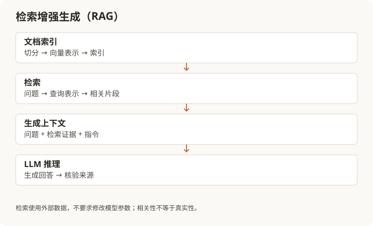

# 第 11 章 人工智能基础：模型、推理与应用架构

> 区分模型参数、输入上下文、检索数据和外部工具，才能理解 AI 系统能力及限制。

## 一、机器学习与大语言模型

机器学习（Machine Learning，ML）利用数据调整模型参数，使模型在特定任务上形成有效的输入输出映射。深度学习（Deep Learning）使用多层神经网络学习表示。

大语言模型（Large Language Model，LLM）是一类处理语言及相关序列任务的模型。常见生成式模型使用 Transformer 架构，通过注意力机制（Attention）处理序列内部的关系，并逐步预测后续 Token。

参数（Parameter）是模型内部参与计算的数值，例如矩阵中的权重。参数通常使用浮点数或量化表示，不应将它们理解为单个二进制开关，也不能将每个参数对应到一条独立知识。

## 二、Token 与生成过程

分词器（Tokenizer）将输入转换为 Token 序列。Token 可以对应一个字符、多个字符、词的一部分或其他符号，具体由分词器决定。中文字符数量与 Token 数量并非固定比例。

自回归生成（Autoregressive Generation）根据已有序列计算下一个 Token 的概率分布，再按照解码策略选择 Token 并继续生成。温度（Temperature）等参数可能改变采样分布，但不能保证事实正确。

幻觉（Hallucination）指生成内容看似合理却缺乏事实依据或与证据冲突。流畅性不能作为准确性的证明；模型还可能产生错误推导或遗漏条件。

## 三、训练与推理

训练（Training）根据数据和目标函数调整模型参数。预训练（Pretraining）建立广泛的表示和生成能力，后训练（Post-training）可能进一步改善指令遵循、任务表现和安全行为。

推理（Inference）使用已有参数处理输入并生成结果。普通对话不意味着模型参数即时更新。上下文窗口（Context Window）限定模型单次处理的 Token 范围，产品还可能通过摘要、检索或持久化记忆提供其他历史信息。

知识截止时间、训练数据覆盖范围与当前能否查询外部资料是不同概念。具有检索能力的系统可以取得训练后发布的信息，但仍需要核验来源。

## 四、Embedding 与 RAG

嵌入向量（Embedding）是将文本等数据映射为数值向量的表示。语义检索利用向量相似度等方法寻找相关内容，而不是只匹配文字。

检索增强生成（Retrieval-Augmented Generation，RAG）通常包含资料切分、索引、检索和将相关材料加入生成上下文的过程。它可以帮助模型使用项目文档或更新资料，无须为每次文档变动重新训练模型。

RAG 并不保证正确：检索可能漏掉关键段落、返回过时材料或忽略访问权限。向量数据库是可选基础设施之一，不等于 RAG 本身。

## 五、从模型到 Agent

多模态（Multimodal）模型可以处理多种数据模态，例如文本、图像或音频，具体输入输出能力取决于模型。

Agent 将模型与工具调用、任务状态、执行环境等结合。搜索、运行代码和更新文件是由外部工具或宿主系统实际执行的操作，而不是模型参数本身的能力。第 12 章将进一步解释权限与验证。

本地推理和云端推理是运行位置的区别，不直接决定模型能力。选择时应考虑模型质量、硬件资源、延迟、成本、数据传输和遥测设置。即使使用本地模型，联网工具也可能传输数据。

## 六、实践：区分生成与证据

准备一份虚构的 API 文档，其中明确规定 POST /orders 返回 201。先询问 AI 一个未提供文档的接口行为，再提供该文档要求引用对应段落回答。比较两次输出，并检查回答是否准确区分已知事实和假设。

实验旨在展示上下文证据如何影响回答，不保证第一次必然错误或第二次必然正确。不要使用包含真实密钥的项目文档。

## 七、与 Agent 协作

请根据指定版本的官方文档检查接口是否存在、参数类型与返回值。若需要外部检索，请标明来源；无法确认时明确说明。生成代码后执行最小测试，并提供实际运行结果。不要把模型推测当作文档事实。

## 八、知识检验

- Token 与汉字或单词为什么不是一一对应？
- 推理和训练对模型参数的影响有何不同？
- RAG 与模型微调有什么区别？
- 模型生成一条工具调用请求为何不等于工具执行成功？

进阶方向：Transformer、注意力、量化、KV Cache、检索排序、模型评估及结构化输出。
