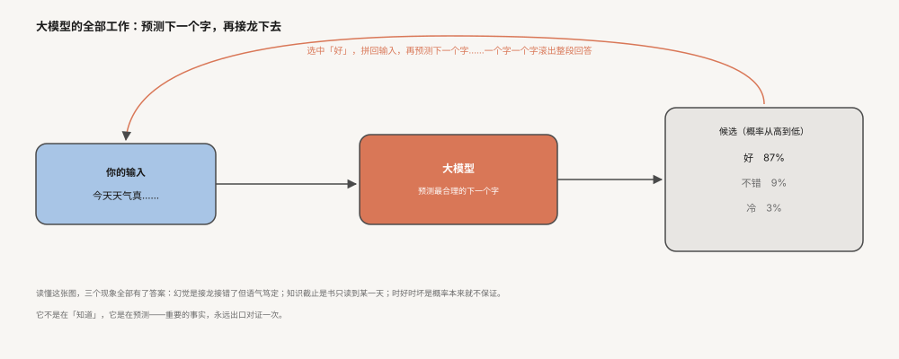

# 第 11 章 AI 全景：认识你雇来的工人

> 它不是在「知道」，它是在预测。理解这一件事，幻觉、健忘、时好时坏就全部有了答案。

## 一、翻车现场

你让 AI 帮忙写代码，它调了一个函数——名字煞有介事，参数整齐，运行时报错：这个函数根本不存在。它一本正经，毫无愧色。你开始怀疑：它到底知不知道自己在说什么？

同一个问题，昨天答得漂亮，今天答得平庸。你换个说法又好了。它时好时坏，你找不到规律。还有：它说不出昨天刚发生的新闻，却对三年前的事如数家珍。

## 二、为什么会这样

### 它的本质：预测下一个字

大模型的全部工作，是给你这句话预测最合理的下一个字，然后一个字接一个字滚出整段回答。它读过的文本量超过一个人几百辈子能读完的规模，把语言的模式——哪些字跟在哪些字后面是合理的——刻进了几千亿个参数（第 2 章的开关）里。

这个本质解释了一切。它博学，因为模式来自全世界的文本；它流畅，因为预测连接毫无停顿；它会编造，因为「编一个听起来合理的函数名」和「说出真实存在的函数名」在预测上都是合法路径——它没有「知道」和「不知道」的开关，只有概率的高低。行话管编造叫幻觉，名字起得准：它不是在撒谎，它只是在接龙。

### 训练与推理：读书的过去和答题的现在

训练是它读书的过去：把海量文本喂进去，反复调整那几千亿个开关，让预测越来越准。训练一次要烧掉天文数字的算力（第 2 章的 GPU），所以模型的知识有一个「截止日期」——你问它截止日之后的世界，它只能靠猜。推理是它答题的现在：你每问一句，它都在跑一遍预测。你付的 token 费（第 16 章）就是推理的钱。

### 上下文窗口：它只记得这顿饭

它没有记忆。每次回答，系统把你们这轮对话的全部历史重新发一遍给它看。能发的总量有上限，行话叫上下文窗口——像一张固定大小的餐桌，聊得越久，最早的话就被撤下桌。第 12 章的会话卫生全从这个事实推出来。

### 多模态与 Agent：会看、会听、会动手

早期的模型只认文字。多模态模型学会了看图、听声音——你给它截图它也能读（但第 15 章的纪律不变：截图里别有密钥）。Agent 是更进一步的方向：给它工具——读文件、跑程序、发请求——让它按计划自己动手，而不只是动嘴。你用 AI 造东西的整套工作流，就是一个 Agent 加一个你。

### 本地与云端：同一批工人的两种雇佣

云端模型最强、按用量付费、你的数据要出门；本地模型在自己电脑里跑（吃你的内存和 GPU，第 10 章），数据不出门，能力弱一档。选择就是第 10 章光谱的 AI 版：敏感与能力之间的取舍。

## 三、怎么办

核验习惯：重要事实必须出口对证。凡是事实性的东西——函数名是否存在、参数是什么、某个说法的出处——用文档或搜索引擎对照一次再采用。它越流畅越笃定，越要核验：流畅和正确是两回事。

知道它擅长与不擅长的边界。擅长：改写、总结、翻译、起稿、写代码、解释概念（这本书全靠它配合写成）。不擅长：精确计算（会算但可能算错，重要数字自己算）、新鲜事实（知识有截止日）、你的私事（它没见过你的数据）、任何「必须百分百正确」的场景。

把「它在预测」当心法用。当它的回答读起来特别像套路套话时，警惕——套路是模式最强的信号。反过来，你给它的信息越具体、越有约束（第 5 章的验收标准），预测的「合理路径」就越接近你想要的。

## 四、带走的问题

- 它上一句让我差点信以为真的话，我核验了吗？
- 我现在用的模型，知识截止到什么时候？
- 我有没有把「流畅」错当成「正确」？
- 这顿饭（上下文）里放了什么？该在桌上的都在吗（第 12 章）？
- 这个任务，数据可以出门吗？可以，用云端；不可以，本地或其他方案。

本章顺便获得的概念：大模型、训练、推理、幻觉、上下文窗口、多模态、Agent、本地模型。
