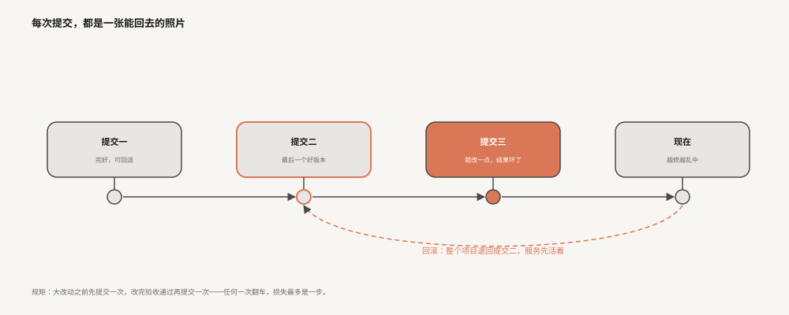

# 第 11 章 昨天还能用，今天怎么就坏了：版本与依赖

> 后悔药是真实存在的，它的行话叫版本控制。学会它之前，你每次「就改一点」都是在走钢丝。

## 一、翻车现场

你让 AI 改三处：一处颜色、一处文案、一处逻辑。改完，坏了两处。你想回到今天早上的版本——发现没有「今天早上」，你一路都是直接改在原文件上的，旧的已经没了。你只能让 AI 对着现状猜哪里改坏了，越猜越乱。

另一个现场更冤：你一个字都没改，东西自己坏了。你跟 AI 说「没人动过啊」，语气理直气壮。AI 半信半疑地开始排查。

两个现场共享同一个教训：软件是活的，变化才是常态，而你需要一套对付变化的方法。

## 二、为什么会这样

### 「没人动过」的三种真相

第一种真相：依赖自己变了。你的东西是用一堆别人写的零件拼起来的，行话叫依赖——比如某个做界面的零件库。那些零件的作者也在更新、修改、停止维护，他们一动，你这边可能跟着晃。你没有动任何东西，但世界动了。

第二种真相：环境变了。服务器的系统更新了、平台的免费政策改了、浏览器升级了。你的程序没变，但它脚下的地面变了。

第三种真相：确实有人动过，只是忘了。包括未来的你自己。三条路里，这条其实最常见，但当事人永远不信。版本控制的第二个好处因此浮现：它不光是后悔药，还是记忆——谁在什么时候改了什么，白纸黑字。

### 版本控制：给整个项目拍快照

备份保的是数据，版本控制保的是「工作过程」：每次改动完成，给整个项目拍一张快照，写一句「这次改了什么」。想回任何时刻，翻出那张快照恢复即可。行话叫 Git，听起来吓人，对普通人的用法其实就一个动作：改完，拍一张。

快照和「另存为」的区别：另存为复制整个文件，快照记录整个项目的完整历史，而且只存差异，几乎不占地方。「最终版 2」「打死不改版」这种文件名，就是没有版本控制时人肉发明的快照——你其实早就需要它了，只是用了最疼的方式在实现。

### 为什么 AI 时代更需要它

AI 改东西又快又猛，一分钟可以改十处。快，意味着你手动「另存为」永远追不上它；猛，意味着回滚的需求比人肉时代高得多。解法很自然：让 AI 替你拍快照。改完一处，让它「提交一次」（行话 commit），一秒钟的事。快照系统的门槛曾经拦住了普通人，现在 AI 把门槛替你踩平了。

## 三、怎么办

最低限度只需要三个动作，全可以让 AI 代劳。第一，初始化：让 AI「给这个项目加上 Git 版本控制」。第二，提交：每次改动验收通过后说「提交一次，说明是改了什么」。第三，回滚：「回到昨天那次提交的状态」，或者「回到上上次」。你甚至不需要背任何命令，这三句话就是全部接口。

节奏规矩：先拍快照，再大改。任何大改动之前，先让 AI 提交一次，确保当前状态是完好的、可回退的。改完再提交一次。这样任何一次翻车，损失最多是「一次改动」，而不是「整个项目」。

仓库和备份的关系再理一遍：GitHub 既是托管平台对接的地方（第 6 章），本身也是一份异地副本——推上去的代码等于存在了云端。所以对你的项目而言，用上 Git 加 GitHub，程序部分的备份自动完成，你只需要额外操心数据部分（第 10 章）。

「就改一点」也要走流程。恰恰是「就改一点」最容易出事，因为你为大改动会紧张，为小改动会松懈，而软件的牵连不看你紧不紧张。规矩面前无小改。

## 四、带走的问题

- 我的项目有版本控制吗？最近一次提交是什么时候？
- 我知道现在这个状态能回退到哪个版本吗？
- 大改动之前，我拍快照了吗？
- 「没人动过啊」这句话说完之前，我排查过依赖和环境吗？
- 我的代码在 GitHub 上有一份异地副本吗？

本章顺便获得的概念：依赖、版本控制、Git、提交（commit）、回滚、仓库。
