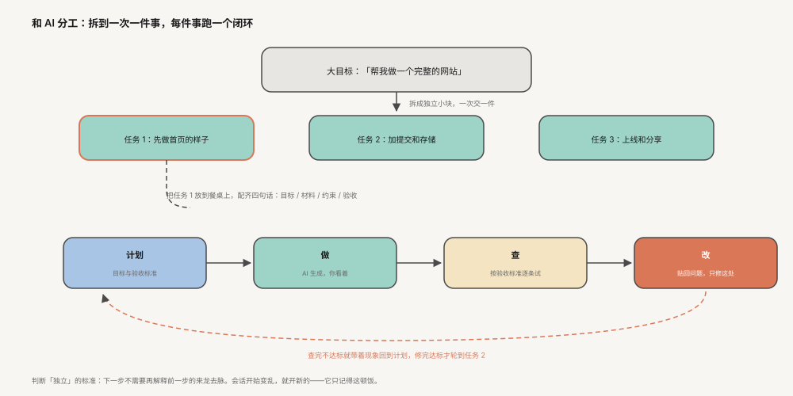

# 第 12 章 和 AI 分工：把活拆成它接得住的小块

> 你雇的这位工人聪明、飞快、记性差、偶尔自信过头。管理它的全部手艺，都从这四条脾气里推出来。

## 一、翻车现场

你对它说：「帮我做一个完整的网站。」三轮改动之后，页面越改越乱，你已说不清哪里是对的。它解释得头头是道，每一步听起来都对，合起来就是不对。

另一个现场：同一个提示词，昨天效果惊艳，今天平平无奇。你开始怀疑自己不会「提问」，到处找「万能提示词」，收藏了十几篇，一篇都没用上。

## 二、为什么会这样

### 上下文窗口决定活的大小

第 11 章说过，它只记得这顿饭（上下文窗口）。一个大而含糊的任务「做个完整网站」，需要它在一张餐桌上同时记住几十个互相牵连的细节——超出了它的注意力，早期决定被撤下桌，后期的修改就开始打架。把活拆成独立小块，每块都在一张干净的餐桌上完成，这是全部手艺的第一条，也是被验证最多的一条。

### 一次一件事：别让它同时想三件事

多个任务挤在一次对话里，它的「思维」会互相打架——任务之间的共同点让它混淆边界，差异点让它来回横跳。第 5 章的「一次只提一个改动」在协作层面同样成立，而且更严格：不是一次只改一处，是一次只谈一件事。

### 验证螺旋：计划、做、查、改

把每件事跑成一个闭环：先用一句话说清这件小事的目标和验收标准（计划）；让它做（做）；你按标准检查（查）；有问题贴回去让它修（改）。这个循环来自工程界几十年的沉淀，名字很多，本质一样：小步快跑，每步有验收。普通人版的要点是——你检查的永远是「效果」，不是代码；跑不跑得起来、对不对，按你定的验收标准来。

### 负空间：识别它接不住的活

比「怎么用好」更值钱的知识是「什么时候不用」。三类活交给它要格外小心：必须精确的（数字计算、法律条文原文）、必须新鲜的（知识截止日之后的事）、必须私密的（你的敏感数据，第 15 章）。识别出来之后，三条路：自己来、换工具、或用完必须核验。省下的时间和坑，就是负空间的收益。

## 三、怎么办

拆活模板。大目标先拆成独立小任务的清单，一次给一个。判断「独立」的标准：这一步做完，下一步不需要再解释前一步的来龙去脉。

每个小任务的四句话。目标：一句话说清要什么。材料：把它需要的文件、数据、报错原文贴上桌。约束：不要动别的部分（第 5 章）。验收：怎么算做好——手机上打开不横滚、点提交出现「已收到」。四句话给完，它几乎不需要猜。

会话卫生。新任务开新对话；旧对话里翻出来的上下文，一半是干扰。开新对话时把必要背景一次性贴齐（它只记得这顿饭），而不是指望它「应该知道」。感觉它开始答非所问、反复纠不住，多数时候不是它变笨了，是餐桌满了——开新的。

验收前先想好正确答案的样子。发任务之前，先自己写下「做好了是什么样」的两三条标准。有了标尺，它的产出你一眼能判；没有标尺，你只能被它的流畅带着走（第 11 章）。

## 四、带走的问题

- 我现在这个任务，拆到「一次一件事」的颗粒度了吗？
- 它的餐桌上有不该在的东西吗？我的材料贴齐了吗？
- 这一步的验收标准，我发任务之前写了吗？
- 这件活，属于它接不住的三类之一吗？
- 这个会话，是不是该开新的了？

本章顺便获得的概念：上下文管理、任务拆分、验证螺旋、负空间、提示词。
