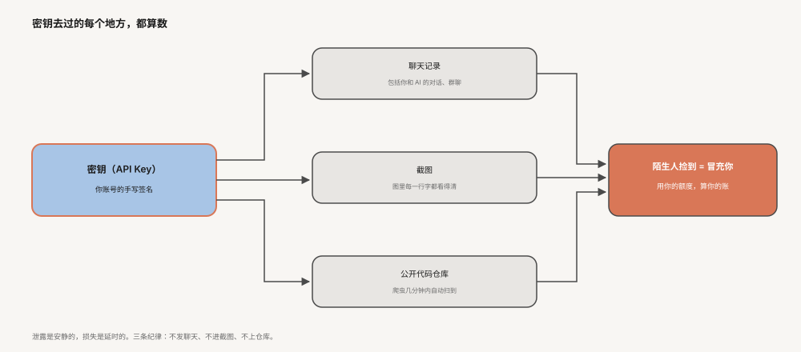

# 第 15 章 打死不能发出去的东西：密钥与隐私

> 有些东西发出去的瞬间不响，过几天才会炸。密钥就是这类东西的典型：泄露是安静的，损失是延时的。

## 一、翻车现场

AI 做的东西用不上某个服务，报错。你为了求助，把整个配置文件截图发进了一个几十人的群——文件里有一串长字符。你不知道那是什么，看起来就是一行乱码。三天后你收到一封扣款邮件，金额比平时高得多。

另一个现场：你把 AI 写的项目原样传到了 GitHub，想请人看看。你没意识到，项目里那个叫 .env 的文件里躺着的，和上面截图里的，是同一种东西。

这两个现场是同一课的两次重修：有些字符是钥匙，钥匙不能给人看。

## 二、为什么会这样

### 密钥：你账号的手写签名

你用 AI 造东西，迟早要用到第三方服务——发短信、查天气、收付款、用某个 AI 模型。每个服务都会发给你一串长字符，行话叫 API Key（密钥）。它的作用等同签名：服务看到这串字符，就认定是你本人在请求，并据此记账、扣费、放行。

服务认字符串，不认人脸。这就是全部风险的根源：拿到这串字符的人，就是你。他用它调用的每一次服务，账都算在你头上；他删的数据、发的消息，责任都记在你名下。

### 会说话的地方比你想的多

你以为秘密只有「发给别人」才算泄露，实际远不止。聊天记录（你和 AI 的对话、群里的消息）、截图（图里的每一行字都看得清）、公开的代码仓库（GitHub 上所有人可搜）、语音和环境里的录音，都是「会说话的地方」。文件里那串乱码，一旦进入以上任何一处，就等于把签好名的空白支票放在了公开桌上。

更隐蔽的是：你不知道谁在看。爬虫每天自动扫描公开仓库找泄露的密钥，通常在泄露后几分钟内就会被人或机器捡走。几分钟后，你可能还在等 AI 回复你那条求助消息。

### 环境变量：把秘密放在代码外面

行话里有个词叫环境变量，听着吓人，意思很简单：把秘密写在代码旁边的配置文件里（常见名字叫 .env），而不是直接写死在代码里。这样代码可以随便给人看、随便上传，秘密留在本机。AI 生成的项目通常已经这么组织了，你只需要知道：那个 .env 文件是保险柜，别把它搬出去。

## 三、怎么办

三条纪律，刻在心里。第一，不发聊天：密钥不发进任何对话框，包括和 AI 的对话、群聊、私信。第二，不进截图：求助要贴图时，遮住或者裁掉所有长串字符。第三，不上仓库：.env 文件不上传公开仓库；拿不准时问 AI「我这个仓库里有没有不该公开的文件」。

请 AI 帮忙时的正确姿势。报错求助不需要真密钥，报错文本里不含密钥本身。如果确实需要让 AI 看配置结构，用假密钥占位：把真值换成 aaaa1111bbbb 这种明显是假的字符串，结构还在，秘密不在。AI 看结构就够了。

泄露应急四步，背下来。第一步，作废：立刻去那个服务的控制台，把泄露的密钥删除或重置——让它变成废纸。第二步，换新：生成新密钥，只更新到你自己的配置里。第三步，查账单：翻那个服务的消费记录，确认泄露期间有没有被冒用。第四步，查用量：看调用记录里有没有你不认识的请求。四步做完，事故才算关账。

最小权限原则。很多服务发密钥时让你选权限：只读还是全部。能只读就别给全部，能用一天就别设一年——权限越小，万一泄露的损失越小。这条原则贯穿后面好几章：对人对服务都成立。

## 四、带走的问题

- 我的项目里有哪些密钥？分别在哪个服务？
- 它们现在出现在哪些「会说话的地方」？
- 我发出去的截图和文本里，有没有长串字符？
- 我的 .env 上过公开仓库吗？
- 泄露四步（作废、换新、查账单、查用量），我能背出来吗？
- 我拿的每个密钥，是只读还是全权？

本章顺便获得的概念：密钥、API、API Key、环境变量、.env、公开仓库、最小权限。
