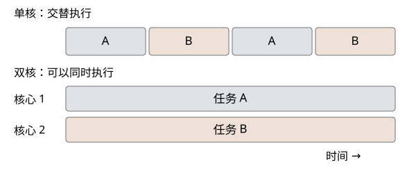

# 一台计算机怎样同时运行多个程序

在前面的教学处理器中，程序计数器指向下一条要执行的指令。假如只有一个处理器核心，它又怎样在编辑器和音乐播放器之间来回工作？

关键在于：执行一个程序时需要保留的信息，并不仅是程序文件本身。

## 正在运行的程序需要自己的状态

一个报名程序可能正在处理第十个人的数据，另一个程序则在等待用户输入。

操作系统需要记录这些程序的运行状态、占用的资源及相关权限。通常，我们把运行中的程序实例及其资源管理单位称为进程（Process）。

同一份程序可以启动多个进程。例如两个独立启动的应用实例可以具有不同的运行状态。进程通常具有用于标识自己的进程编号（Process ID，PID）。

程序是计算规则的表达，而进程是运行中的实例。关闭一个进程不等于删除安装在硬盘上的程序。

## 保存当前执行位置，再去执行另一项工作

假设一个核心正在运行程序 A。系统可以在适当时刻保存 A 的执行位置和有关寄存器状态，然后恢复程序 B 之前保存的执行状态，让处理器继续执行 B。

下一次切换时，再保存 B 并恢复 A。

这类切换称为上下文切换（Context Switch）。上下文在这里指恢复执行所需要的状态信息。

如果切换足够频繁，多个程序就能够在同一段时间内不断取得进展，即使单个核心在某一瞬间只能执行有限数量的工作。

## 并发和并行为什么不是一个概念

多个任务在同一段时间内都有进展，称为并发（Concurrency）。多个任务在物理上同时执行，则称为并行（Parallelism）。

单核心可以通过任务切换形成并发；多个核心则提供了同时执行不同任务的可能。

但任务并不总是需要处理器。有些任务在等待用户点击，有些在等待存储设备完成读取。此时系统可以把处理器时间分配给其他可以继续工作的任务。

操作系统中负责选择哪些可运行任务获得处理器时间的机制称为调度器（Scheduler）。

## 一个进程也可以有多条执行路径

报名应用可能一边接受用户操作，一边读取以前的报名信息。

为了让同一个应用组织多条执行路径，现代操作系统通常提供线程（Thread）。同一个进程中的线程通常共享地址空间和部分资源，但具有各自的执行位置及相关运行状态。

在许多现代系统中，线程是处理器调度的重要单位。

共享数据既能方便协作，也会引入风险。例如两个线程同时读取报名人数 19，都决定增加 1，最后可能发生更新丢失。后续讨论数据库和可靠性时，我们会深入研究如何控制这种操作顺序。

## 为什么等待中的任务不应该占用整个处理器

可以先用三个简化状态理解调度：

- 就绪（Ready）：具备继续执行的条件，等待处理器。
- 运行（Running）：正在获得处理器执行机会。
- 阻塞（Blocked）：正在等待某个条件，例如读取完成。

运行任务可能因为等待输入而进入阻塞状态。条件满足后，它进入就绪状态，再由调度器选择执行。系统也可以在任务尚未主动让出处理器时重新取得控制。处理器支持中断（Interrupt）：硬件定时器等设备发出事件后，处理器可以按照规定暂停当前指令执行路径，转入相应的处理程序，再恢复原来的任务或调度其他任务。定时器产生的时钟中断是实现这种控制的一种常见机制。这类调度方式称为抢占（Preemption）。

具体系统还可能区分更多状态。这个模型帮助解释为什么一个程序已经启动，却不一定正在使用 CPU。

## 共享状态为什么需要同步

假设两个线程都要将共享计数 19 增加 1。若两者先分别读取 19，再分别写回 20，就丢失了一次更新。

临界区（Critical Section）是需要受到适当协调的一段操作。互斥锁（Mutex）可以让遵守同一锁规则的线程轮流进入临界区。

但互斥不自动等于业务正确：即使两个报名操作依次执行，仍需在受保护的范围内检查容量并更新记录。在多进程或多台服务器之间，还需要选择能覆盖实际共享资源的协调机制。第四十五章将用数据库事务解决这类问题。

## 亲自观察运行状态

Windows 用户可以打开任务管理器，macOS 用户可以打开活动监视器。尝试找到一个正在运行的应用，观察其进程编号、CPU 使用情况和内存占用。

启动应用和退出应用后，观察相关进程变化。一个应用可能包含多个进程，也可能退出窗口后仍有后台进程，不应仅凭窗口数量判断进程数量。

不要结束不认识的系统进程。

现在我们知道系统能够管理许多执行任务，但还有一个重要问题：怎样让多个进程使用自己的内存而不随意覆盖其他进程的数据？