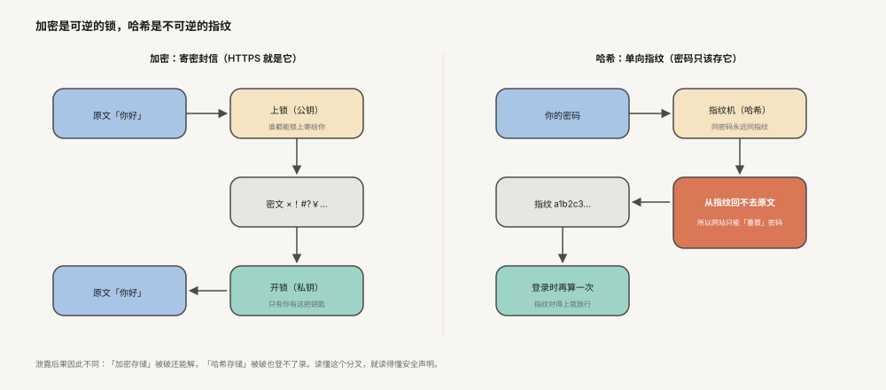

# 第 19 章 加密与哈希：锁和指纹

> 「忘记密码」永远只能重置不能找回——这一个细节，藏着密码学最核心的分野：可逆的锁，和不可逆的指纹。

## 一、翻车现场

你在某网站点了「忘记密码」，收到重置邮件，设置新密码，登录成功。你突然意识到一件事：从头到尾，网站从来没有把你的旧密码告诉你。它到底知不知道你的密码？

另一个现场：某平台宣传「数据加密存储」，后来还是泄露了，用户密码照样被破解。加密了怎么还能破？还有一个词你听过很多次：「端到端加密」——到底谁看得到？

## 二、为什么会这样

### 加密：可逆的锁

加密是把内容变成乱码，但拿着钥匙可以还原——它是锁，锁上能开。你用一把钥匙锁上箱子，收件人用另一把（或同一把）钥匙打开。第 8 章的 HTTPS 就是加密：寄密封信，沿途谁都读不了，收件人拆得开。

互联网的加密有个巧妙的分身术：公开的锁和私有的钥匙配对。任何人都用「公开的锁」给你寄信（所以陌生人也能给你写加密信），只有你手里的私钥能拆。你每次打开 https 网址，浏览器和服务器就在几毫秒内完成这套握手（第 8 章）。

### 哈希：不可逆的指纹

哈希是把内容压成一段固定长度的「指纹」：同一份内容永远算出同一枚指纹，但从指纹无法还原内容——它只单向，不可逆。网站存你的密码，存的是指纹而不是密码本身：你登录时，它把你输入的密码再算一次指纹，两枚对得上就放行。

这就是「忘记密码只能重置」的答案：网站手里只有指纹，它也不知道你的密码。重置的本质是「验证你是你之后，让你设一个新的」。这也是安全的底线：就算数据库被偷，小偷拿到的也是指纹堆，直接登不了录。宣传语里的门道由此而来：「加密存储」被破了还能解，「哈希存储」被破了也登不了——后者才是密码该有的待遇。

### 端到端加密：钥匙只在当事人手里

普通加密的信件，平台也有钥匙（它得帮你转发）。端到端加密的意思是：钥匙只在你和对方手里，平台只负责递信，自己都拆不开。聊天软件宣称的「端到端」，含义就是平台看不见内容。代价也随之而来：忘了密码、丢了设备，平台真的救不了你——强加密不给任何后门，包括给你自己的后门。

## 三、怎么办

读懂安全声明的一个分叉。看到「你的数据是加密的」，追问一句：是加密（可逆，平台有钥匙）还是哈希（不可逆）？密码类应该哈希；文件类通常是加密。泄露后果完全不同。

选服务时看一眼加密层级。涉及私密对话和敏感笔记的服务，优先选有端到端加密的；但开了端到端，第 16 章的备份纪律要执行得更严——平台帮不了你。

密码管理器为什么可信，现在你能说清原理了：它把你的所有密码加密在一个保险库里，钥匙是你唯一需要记住的主密码（第 18 章）。它不是多记了一堆密码，是把你从「记密码」里解放出来去记住一把钥匙。

## 四、带走的问题

- 我常用的服务，密码存的是指纹还是原文？
- 这个服务宣称的加密，是锁还是端到端？平台看得见我的内容吗？
- 我的主密码，是唯一需要我记住的钥匙吗？
- 我能解释「为什么忘记密码只能重置」了吗？
- 我的东西开 了端到端，备份纪律跟上了吗（第 16 章）？

本章顺便获得的概念：加密、哈希、端到端加密、公钥与私钥、重置与找回。
