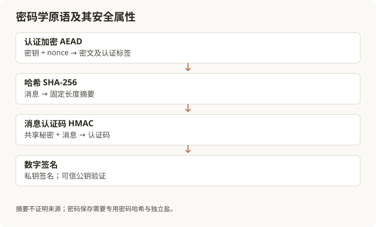

# 第 20 章 密码学基础：加密、哈希与数字签名

> 不同密码学原语提供不同安全属性，不能将加密、哈希和身份认证混为一谈。

## 一、密码学解决哪些问题

加密（Encryption）使用算法及密钥将明文转换为密文，解密恢复明文。密码学哈希（Cryptographic Hash）将任意长度输入映射为固定长度摘要。数字签名（Digital Signature）用于验证消息完整性及签名者持有相应私钥的事实。

| 机制 | 主要用途 | 常见实例 |
|---|---|---|
| 对称加密 | 保护数据机密性 | AES-GCM、ChaCha20-Poly1305 |
| 公钥密码机制 | 密钥建立、签名或特定加密用途 | X25519、Ed25519、RSA |
| 密码学哈希 | 内容摘要及完整性相关操作 | SHA-256 |
| 消息认证码（MAC） | 使用共享秘密验证消息真实性和完整性 | HMAC-SHA-256 |
| 密码哈希 | 提高离线密码猜测成本 | Argon2id、scrypt、bcrypt |

哈希本身不能证明数据来源。如果攻击者能同时替换文件与摘要，仅比较摘要不能建立可信来源。



## 二、对称加密与公钥机制

对称加密（Symmetric Encryption）使用共享秘密密钥。现代应用通常采用认证加密（Authenticated Encryption with Associated Data，AEAD），同时提供机密性和完整性保护。

Nonce 是某次密码学操作使用的数值，其唯一性或随机性要求由算法决定。例如 AES-GCM 在同一密钥下重复使用 nonce 会破坏重要安全保证。应使用成熟密码库及其推荐接口，而不是自行设计加密协议。

公钥密码学（Public-key Cryptography）使用相关联的公钥和私钥。并非所有公钥算法都支持加密与签名两种操作。例如 Ed25519 用于签名，X25519 用于密钥协商。

现代 TLS 通常使用密钥协商建立会话秘密，通过证书及签名认证服务器，并使用对称认证加密保护应用数据。不能将现代 HTTPS 简化为浏览器使用服务器公钥加密全部数据。

## 三、哈希、密码保存与数字签名

密码学哈希需要具备抗原像、抗第二原像和抗碰撞等安全属性。抗原像意味着从摘要寻找对应输入在计算上应当困难，并不意味着低熵输入无法被猜测。不同输入也可能产生相同摘要，这是固定长度输出的数学限制。

用户密码不应直接采用快速通用哈希保存。密码哈希算法使用独立随机盐（Salt）及可配置的计算成本，降低预计算和大规模离线猜测的效率。盐通常不需要保密。即使数据库保存的是密码哈希，弱密码仍可能被破解，因此还需要合理的认证和访问保护措施。

数字签名使用私钥生成签名，使用公钥验证。验证成功并不自动证明公钥属于预期主体，还需要可信的公钥分发或证书机制。

## 四、传输加密、静态加密与端到端加密

传输加密（Encryption in Transit）保护网络传输过程；静态数据加密（Encryption at Rest）保护存储中的数据。二者均不能自动阻止有权限的应用读取明文。

端到端加密（End-to-end Encryption，E2EE）要求预期通信端点控制解密能力，中间服务通常不持有解密消息内容所需的密钥。实际保证取决于协议、客户端实现、密钥管理、设备信任和备份机制。元数据未必受到相同保护。

密钥恢复、设备迁移与数据备份必须结合具体产品设计评估。不能假设所有端到端加密产品具有相同的恢复能力。

## 五、实践：观察摘要变化

如果安装了 Python 3，可以运行：

```python
import hashlib

for value in (b"hello", b"hello!"):
    print(hashlib.sha256(value).hexdigest())
```

观察两组固定长度的十六进制摘要。这个实验展示输入变化会产生不同摘要的常见情况，不证明哈希绝对不会碰撞，也不是密码存储示例。

下载可信软件时，可比较通过可信渠道获得的官方 SHA-256 摘要与本地文件摘要，验证内容是否一致。若需要验证发布者身份，应进一步检查可信数字签名。

## 六、与 Agent 协作

请分别说明项目中传输数据、存储文件、用户密码和签名验证使用的安全机制。检查是否采用成熟密码库、适当的密码哈希、密钥管理及证书验证。不得自行设计密码算法，不得把真实私钥输出到日志。

## 七、知识检验

- 为什么 SHA-256 不能直接作为用户密码的推荐存储方案？
- 哈希与数字签名提供的安全属性有什么不同？
- TLS 为什么同时使用公钥机制与对称加密？
- 为什么静态数据加密不能代替授权？

进阶方向：AEAD、PKI、证书链、密钥派生函数、前向保密、密码学协议分析。参考 RFC 8446、RFC 9106 和 FIPS 180-4。
