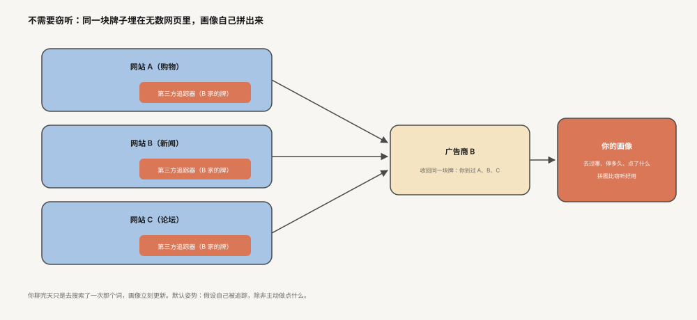

# 第 21 章 隐私与追踪：谁在看你

> 你刚和朋友聊完某样东西，购物软件就推荐了它。答案多半不是窃听——是有一群陌生人一直在光明正大地看你。

## 一、翻车现场

昨晚和朋友聊天提到某个商品，今天购物 App 的首页赫然推荐着它。你后背发凉：手机在窃听吗？用「微信登录」登进一个小网站，它请求你的头像、昵称、手机号——你全部给了。每个 App 首次打开都让你点「同意隐私政策」，一万字，你从没读完过。

你用 AI 造的东西也在收集用户数据（第 13 章上线后）——你的用户面对那一万字的感受，和你一模一样。

## 二、为什么会这样

### 不需要窃听：追踪器一直在明处

互联网的商业模式建立在「看你」之上，而且都是光明正大的：每张网页里埋着几个到几十个追踪器，你访问了什么、停了多久、从哪来、点了什么，全被记下。这些碎片从无数个网站汇到一起，拼出一张比你想象中完整得多的画像——你聊完天去搜索了那个词（哪怕只搜了一次），画像立刻更新。窃听既冒险又多余，明处的追踪好用得多。

### Cookie：网站发你的身份牌

Cookie 是网站发给你浏览器的一张小牌，下次访问你自动出示。它本是好发明：购物车靠它记住你放了什么（第一方 Cookie，只在本店有效）。被玩坏的是第三方 Cookie——你逛 A 店，A 店页面里埋着 B 广告商的牌子，B 拿着牌记录你在所有埋过它牌的店里的足迹，跨店跟单。现代浏览器已经开始限制它，但「设备指纹」这类新玩法（用你的屏幕、字体、时区拼出独一无二的你）仍在继续。禁令和玩法一直在赛跑，你的默认姿势应该是：假设自己被追踪，除非主动做点什么。

### OAuth 登录：把信任外包的便利与代价

「用微信登录」「用 Google 登录」这套机制行话叫 OAuth。它免去了再注册一个账号，但也签了一份授权：第三方拿到了你授权的那部分信息（头像、昵称、手机号），并且获得了你账号的一部分入口。便利是真的，代价也要看清楚：授权给它什么、它拿去干什么、你注销时它删不删。授权是可以收回的（微信和 Google 的账号安全设置里都有「授权管理」），收回要记得去做。

### 隐私政策：不读全文，读三问

一万字的隐私政策，普通人读三问就够了：收我什么（收集范围）、给谁（共享与第三方清单）、我怎么删（删除与导出）。三问找不到答案的服务，本身就是一个信号。第 17 章讲过选平台先问「数据能不能搬走」——隐私三问是同一件事的另一面：数据进来之前就问清楚。

## 三、怎么办

授权三查。每次用微信、Google 或其他账号登录第三方，看清楚它要的清单：只要头像昵称，给；要通讯录或支付能力，想三秒——一个记账工具要通讯录干什么？

浏览器隐私三件套。第一，限制第三方 Cookie（主流浏览器设置里都有开关）。第二，扩展只装必要和可信的——浏览器扩展拥有你所有网页的读取权限，是权限最高的软件品类，来路不明的扩展等于把家门钥匙给了陌生人（这条给你的用户也一样，第 19 章）。第三，搜索和浏览要分账号的话，用浏览器自带的独立窗口。

给你的东西列数据出口清单。你上线的工具收集了用户什么（第 19 章）、存在哪、谁能看到——写下来，一页纸。它既是你的隐私政策的草稿，也是出事时的应对底稿。

对 AI 产品同理。你和 AI 的对话会留下（第 15 章）；喂给它的敏感数据可能进训练或被人工复核——发之前过一遍第 15 章的三条纪律。

## 四、带走的问题

- 我手机里授权过的第三方登录，最近一次清理是什么时候？
- 我的浏览器扩展清单里，有没有来路不明的？
- 我上线的工具收集的用户数据，我能列出出口清单吗？
- 我用的 AI 服务，对话数据会怎么处理？我看三问了吗？
- 下次「同意并继续」之前，我会点开那三问吗？

本章顺便获得的概念：第三方追踪、Cookie、设备指纹、OAuth、隐私政策、数据主权。
