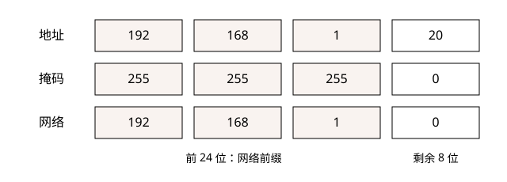

# 为什么有了 MAC 地址还需要 IP 地址

上一章的交换机能够在局部网络内按照目标 MAC 地址转发以太网帧。但互联网由许多网络组成，需要一种能够跨越不同网络的通信方法。

互联网协议（Internet Protocol，IP）为这类通信规定了数据组织、地址和转发方面的基本规则。

## IP 地址表示什么

IP 地址是 IP 通信使用的地址。常见的 IPv4 地址由 32 位组成，通常将四个字节分别用十进制书写，并使用点分隔。

例如：

192.168.1.23

这四个数字分别对应四个字节，因此每个数字的范围是 0 到 255。

IPv6 使用 128 位地址，通常采用由冒号分隔的十六进制表示。本章以 IPv4 为例建立基础模型，后面遇到 IPv6 时不应把 IPv4 的具体机制机械套用过去。

## 怎样知道目标是不是属于同一个网络

假设 A 的地址是 192.168.1.23，B 的地址是 192.168.1.45，两者使用前缀长度 24。

我们写作 192.168.1.23/24。这表示地址中的前 24 位用于识别这里的网络前缀，剩余位用于区分该范围内的地址。

在这个例子中，A 和 B 的前 24 位相同。它们所在的普通直连子网可表示为 192.168.1.0/24。

子网掩码（Subnet Mask）是另一种表示 IPv4 前缀范围的方法。/24 对应 255.255.255.0。

注意，不能仅看两个 IP 地址的前几个数字就判断是否属于同一个子网，必须结合前缀及系统实际的网络配置。

## 用一次地址计算判断是否在同一子网

IPv4 地址有 32 位，通常用四个十进制数展示，每个数对应八位。例如 192.168.1.20。

假设本机地址为 192.168.1.20/24。斜线后的 24 表示前 24 位是网络前缀。对应的子网掩码（Subnet Mask）为 255.255.255.0，也就是前三个字节全部为 1、最后一个字节为 0。

通过按位与，可以取得网络地址：

| 地址 | 与掩码 255.255.255.0 运算后的结果 |
|---|---|
| 192.168.1.20 | 192.168.1.0 |
| 192.168.1.80 | 192.168.1.0 |
| 192.168.2.80 | 192.168.2.0 |

在这个简单直连网络模型中，前两个地址属于同一子网，第三个地址不属于本机的 /24 子网。实际系统还需要依据路由表选择发送接口与下一跳。

不要把 /24 当成所有网络的固定配置。前缀可以在不同位数处结束，因此不能始终只比较前三个十进制数字。

## IP 数据如何交给以太网

IP 协议组织的数据单元常称为 IP 包（IP Packet）。如果当前一段通信使用以太网，IP 包通常作为以太网帧承载的数据之一。

这样，一份传输数据同时具有两个层次的地址：以太网帧中的 MAC 地址，用于当前链路上的交付；IP 包中的 IP 地址，用于 IP 网络中的寻址与转发。

在常见 IPv4 以太网中，如果目标是直连网络中的设备，而发送方尚不知道其 MAC 地址，可以通过地址解析协议（Address Resolution Protocol，ARP）取得相应映射。

IPv6 使用邻居发现等机制，不使用 IPv4 的 ARP。

## IP 地址怎样分配

有些地址由使用者或管理员手动配置。许多家庭和办公网络通过动态主机配置协议（Dynamic Host Configuration Protocol，DHCP）提供 IP 地址、前缀或其他网络配置。

192.168.0.0/16 属于常见 IPv4 私有地址范围。这类地址可以在不同组织的内部网络中重复使用，不作为普通全球互联网路由的目的地址直接传播。

目前先理解私有网络中的地址不具有全球唯一的可达意义。下一章再解释内部设备如何通过路由器访问外部服务。
