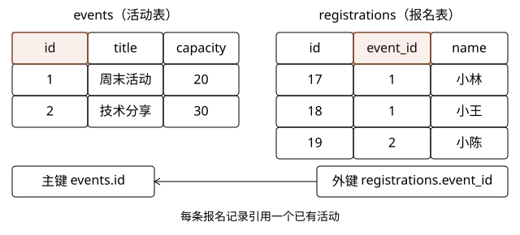

# 已经有文件了，为什么还需要数据库

假设报名活动已经积累了十万条记录。现在我们希望找到编号为 5021 的申请者，再检查他报名了哪些活动。

如果每次都需要把所有记录读进内存，再逐条寻找，不仅浪费资源，也会让多个程序共同修改数据变得困难。

当然，我们可以自己设计文件组织方式、查找机制、修改规则和异常恢复机制。但是，这些问题已经被许多软件反复研究过。

用于按照一定结构管理数据、提供查询和修改能力的软件，通常称为数据库管理系统（Database Management System，DBMS）。数据库（Database）则是由相应机制管理的数据集合。

## 用表描述同一类事物

关系型数据库（Relational Database）常以表的形式组织数据。在报名应用中，我们可以建立活动表：

| id | title | capacity |
|---:|---|---:|
| 1 | 周末活动 | 20 |
| 2 | 技术分享 | 30 |

再建立报名表：

| id | event_id | name |
|---:|---:|---|
| 17 | 1 | 小林 |
| 18 | 1 | 小王 |
| 19 | 2 | 小陈 |

一行代表一条记录，一列代表一种属性。

我们没有在每条报名记录中重复保存活动名称和总名额，而是通过 event_id 指出它所属的活动。

## 为什么需要能够唯一识别记录的值

假如两个人都叫小林，仅凭姓名就无法确定要取消哪一次报名。

能够唯一标识一行记录、并被选定作为主要标识的键，称为主键（Primary Key）。

报名表中的 id 就可以承担这一职责。不同报名者即使具有相同姓名，仍能拥有不同编号。

报名表中的 event_id 引用活动表的 id，这样的引用可以通过外键（Foreign Key）约束表达。数据库可以据此检查相关活动是否存在。



## 为什么不把活动名称复制到每条报名记录

假设同一次活动有一百条报名记录，每一条都保存了活动名称。如果活动改名，程序就需要更新所有相关记录。若某些记录没有更新，就可能出现同一次活动拥有多个名称的矛盾状态。

把活动自身的属性保存在活动表，再由报名表通过 event_id 引用活动记录，可以减少这种重复及修改不一致的问题。关系型数据库设计中，对数据关系进行适当组织、减少某些冗余及修改异常的过程称为规范化（Normalization）。

这并不是说重复数据一定错误。某些历史记录确实需要保存当时的价格或活动名称；某些性能设计也会有意保存可以重新计算的结果。关键是区分数据的含义及更新规则。

## 约束怎样阻止无效记录进入数据库

常见关系数据库约束包括：

| 约束 | 所表达的规则 |
|---|---|
| PRIMARY KEY | 主要记录标识 |
| NOT NULL | 指定列不允许 NULL |
| UNIQUE | 对指定列或列组合实施唯一性要求 |
| CHECK | 对记录的值实施规定的条件 |
| FOREIGN KEY | 检查指定的引用关系 |

NULL 表示缺少或未知等情况，具体查询语义由 SQL 规定，不等于空字符串或数字零。不同数据库对 UNIQUE 中 NULL 的处理也可能不同。

下面的实验显式开启 SQLite 外键检查，并验证错误的活动引用会被拒绝：

```python
import sqlite3

with sqlite3.connect(":memory:") as db:
    db.execute("PRAGMA foreign_keys = ON")
    db.execute("CREATE TABLE events (id INTEGER PRIMARY KEY)")
    db.execute("""
        CREATE TABLE registrations (
            id INTEGER PRIMARY KEY,
            event_id INTEGER NOT NULL REFERENCES events(id)
        )
    """)
    db.execute("INSERT INTO events VALUES (1)")
    db.execute("INSERT INTO registrations VALUES (17, 1)")
    try:
        db.execute("INSERT INTO registrations VALUES (18, 99)")
    except sqlite3.IntegrityError:
        pass
    else:
        raise AssertionError("invalid foreign key accepted")
    assert db.execute("SELECT COUNT(*) FROM registrations").fetchone()[0] == 1
db.close()
```

外键可以保护活动引用，却不能单独保证报名人数不超过容量。跨多行的业务约束还需要适当的事务与并发控制。

## 数据库不只是电子表格

表格软件也可以显示一组行和列。关系型数据库的关键并不是这种显示形式，而是通过明确的关系、约束及查询操作管理数据。

数据库可以拒绝不满足约束的写入。例如，已经存在的主键不能随意重复插入。

数据库是否允许空值、是否检查外键、怎样处理多个同时访问者，仍然取决于具体系统、配置及表的定义。

SQLite 是一种可嵌入应用的数据库引擎；PostgreSQL 等系统则通常以独立服务的形式提供数据库能力。关系型数据库并不必然要求单独部署一台服务器。

下一章将学习程序如何向数据库表达查询要求。
