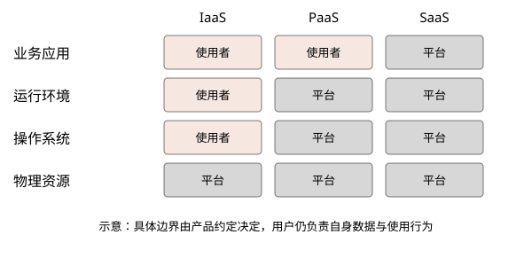

# 云计算究竟把哪些工作交给了别人

服务需要计算、网络和存储资源。如果我们不希望自己购买和维护所有物理设备，可以使用由其他组织提供的计算服务。

云计算（Cloud Computing）通常指通过网络按需获得计算、存储和其他资源的服务模式。它背后仍然具有真实的硬件、网络、电源和存储设备。

## 不同服务承担不同责任

假设我们租用一台虚拟机，自己安装系统组件、配置应用并维护运行环境。这样的平台主要提供基础资源，属于基础设施即服务（Infrastructure as a Service，IaaS）的常见形式。

另一类平台可以直接接收代码或构建产物，由平台管理更多应用运行环境。这通常称为平台即服务（Platform as a Service，PaaS）。

还有一些服务直接提供完整的可使用软件，例如在线文档。这类模式常称为软件即服务（Software as a Service，SaaS）。

分类的目的是帮助理解工作由谁负责，不是说每种产品都必须完全符合某个固定类别。

## 托管数据库并不是不用管理数据

我们可以自行安装数据库，也可以选择托管数据库（Managed Database）。平台可能负责备份、运行维护、版本管理等工作，具体取决于服务约定。

开发者仍然需要设计表结构、正确的事务、查询、访问权限及恢复目标。不能因为数据库由平台管理，就认为所有业务风险已经消失。

## 为什么无服务器计算仍然需要服务器

某些平台可以根据请求或事件安排应用代码运行，使用者不必直接管理相应服务器的生命周期。这类方式常被称为无服务器计算（Serverless Computing）。

它并不意味着不存在服务器，而是隐藏了部分资源管理工作。使用者仍需考虑执行时长、启动延迟、运行环境及持久化限制。

例如，不能假定两次独立调用一定在同一个进程执行，也不能假定本地临时文件一定能在下次调用时继续存在。

## 无服务器函数如何处理多个请求

假设某个平台在收到报名请求时为函数安排运行环境。如果已有可复用环境，可能直接处理请求；如果没有，则需要先建立环境并装载代码。

建立新环境可能产生额外延迟，常称为冷启动（Cold Start）。平台也可能同时建立多个实例处理不同请求。开发者不能依赖某个进程中的全局变量作为所有报名者共享的权威人数。

因此，无论使用长期运行的进程还是按请求安排的函数，仍需明确持久化数据的位置、并发操作的事务边界和失败后的处理规则。

选择托管服务还要检查平台限制，例如最长执行时间、并发配额、连接数、网络能力及费用。平台负责一部分运行工作，不会自动完成应用的可靠性设计。

## 从需求选择部署方式

报名系统可以使用静态托管分发网页，使用虚拟机、容器平台或其他运行服务承载业务，并选择适合的数据库。

选择之前应该明确是否需要持续运行、长期连接、独立资源、特定运行环境以及维护能力。云服务是实现需求的工具，而不是需求本身。

下一章研究访问量增加时，多个运行实例怎样协作。
