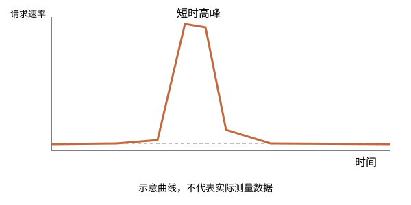

# 怎样判断应用需要多少服务器资源

我们已经能够选择虚拟机、容器和托管服务，并在需要时扩展实例。究竟需要多少资源？

## 日访问量不能直接决定服务器容量

假设一天有 10000 次请求，一天共有 86400 秒，平均每秒约 0.116 次请求。

如果报名开放后十秒内收到 500 次请求，这段时间内平均每秒就有 50 次请求。两种数字相差很大。

每秒请求数（Requests Per Second，RPS）是一种常见的请求速率指标。实际资源需求取决于高峰负载、请求工作量、响应目标及失败处理方式。



## 延迟和吞吐量描述不同现象

发出请求到获得结果所经历的时间称为延迟（Latency）。单位时间完成的工作量称为吞吐量（Throughput）。

系统每秒完成 100 次请求，不代表每个请求都在 0.01 秒内完成，因为许多请求可以同时处于处理中。

平均延迟还可能掩盖特别慢的请求。第 95 百分位延迟（P95）表示大约 95% 的观测值不超过相应延迟值，具体计算方法可能因工具而异。

我们可以同时规定测试条件、请求速率、P95 响应时间与允许的错误率，使性能要求成为可验证的目标。

## 用测试结果进行容量估算

假设在规定的数据规模及请求组成下，一个实例经测试能够稳定处理每秒 30 次请求。面对每秒 50 次请求，两个实例的理论合计能力为每秒 60 次。

这仍然不是生产保证。共享数据库、网络以及实例故障都可能影响结果。需要通过负载测试（Load Test），在授权且可控的实验环境中生成相应请求，观察整体表现，而不是向未经授权的网站发送大量流量。

## 并发请求数量与处理时间有什么关系

在稳定系统中，若使用一致的测量边界，长期平均在处理或等待的请求数量 L，与平均有效到达速率 λ 和平均停留时间 W 满足 L = λ × W。这是 Little 定律（Little's Law）的常见表达。

例如每秒进入并完成约 50 次请求，平均每次在系统中停留 0.2 秒，那么系统中的平均请求数量约为 10。这里包含所选边界内正在处理及等待的请求，并不等于必须配置 10 个 CPU 核心。

当输入速率长期超过系统可持续处理能力时，等待队列可能不断增加，此时不能直接把稳态公式当成容量保证。


## 怎样验证尾部延迟

下面使用虚构的 100 个耗时样本计算平均值和采用最近秩方法（Nearest Rank）的 P95、P99：

```python
from math import ceil

samples = sorted([20] * 90 + [100] * 5 + [500] * 5)
def percentile(p):
    return samples[ceil(p / 100 * len(samples)) - 1]

assert sum(samples) / len(samples) == 48
assert percentile(95) == 100
assert percentile(99) == 500
```

单位为毫秒。虽然平均耗时为 48 毫秒，但仍存在一批耗时 500 毫秒的请求。百分位数的具体计算方法应与监控或测试工具的定义保持一致。

真实容量测试还需要观察成功率、实际到达速率、数据库等待及队列增长。不能只对成功的快速请求计算延迟，而忽略超时与失败。

## 费用来自实际使用的资源

云服务可能按实例运行时间、请求次数、存储容量、数据传输量等指标计费。

使用虚构的教学单价：每个实例每小时 0.10 元，两个实例运行 720 小时，则实例费用为 144 元。这个结果尚未包含数据库、网络及备份费用，不代表任何真实云服务报价。

```python
from decimal import Decimal

instance_cost = Decimal("0.10") * 2 * 720
assert instance_cost == Decimal("144.00")
print(instance_cost)
```

预算需要结合真实计费规则。预算提醒也不一定能够自动停止资源或限制全部费用。

至此，我们已经理解一个应用如何从代码变成可访问的网络服务，以及如何管理它所依赖的计算资源。接下来将研究如何让软件不仅能够运行，还能被持续验证、修改和可靠交付。
