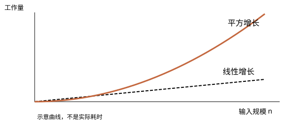

# 得到正确答案之后，为什么还要考虑算法

第一部已经建立算法的概念：为了完成某项计算而规定的一组步骤。现在我们拥有了实际程序、数据库和网络知识，可以进一步研究算法如何影响系统的工作量。

## 同一个问题可以有不同的解决步骤

假设收到 1000 个报名编号，希望判断是否存在重复。

一种办法是对每个编号检查它后面的所有编号。即使所有编号都不重复，也必须检查许多对数字。

另一种办法是维护一个已经见过的编号集合。每次取得新编号，先检查集合是否已经包含它，再将它加入集合。

集合（Set）是一种表达不重复元素的数据结构。它在 Python 中可以使用 set 建立。集合并不规定所有编程语言都必须采用同一种内部实现。

```python
def has_duplicate(ids):
    seen = set()
    for value in ids:
        if value in seen:
            return True
        seen.add(value)
    return False

assert has_duplicate([17, 18, 17])
assert not has_duplicate([17, 18, 19])
```

这个例子将查找问题转化成对辅助结构的查询，代价是需要额外存储已经见过的值。

## 输入规模增加时，工作量如何变化

对 n 个元素逐对比较，在没有提前结束的情况下，需要 n×(n-1)/2 次比较。1000 个元素对应 499500 次比较。

如果使用具有适当平均查找性能的集合，每个元素通常只需进行有限数量的集合操作，整体平均工作量可以随元素数量近似线性增长。具体保证取决于集合实现和输入条件。

描述算法工作量如何随输入规模增长的概念称为时间复杂度（Time Complexity）。常用大 O 记号描述渐近上界，例如 O(n²) 和 O(n)。它不是具体的毫秒数。

空间复杂度（Space Complexity）则关注所需额外存储空间随输入规模变化的情况。



## 理论分析不能代替测量

一个理论增长速度较好的算法，在很小的数据规模上不一定更快。程序运行还受到硬件、运行时、数据分布、内存访问和其他系统活动的影响。

进行基准测试（Benchmark）时，应记录输入规模、环境、重复次数与测量指标。不能只运行一次，然后把偶然的结果当成普遍规律。

如果真实系统慢在数据库连接等待，那么优化一个很少执行的计算函数可能没有实际收益。对程序运行过程中时间或资源分布的测量称为性能剖析（Profiling）。

算法选择要服务于实际问题，而不是追求看起来最复杂的实现。下一章将讨论，怎样在修改软件时确认正确性没有被破坏。
