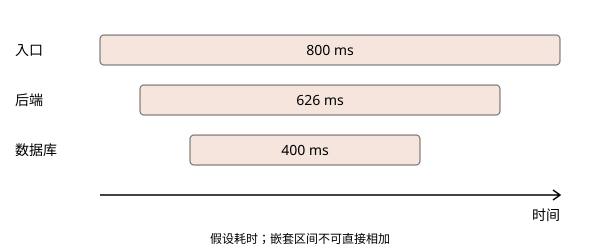
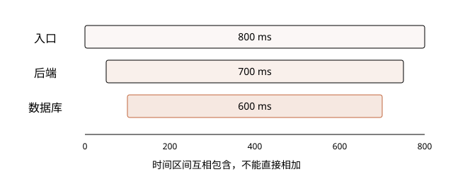

# 服务正在运行，我们怎样知道它是否正常

报名服务已经部署。某天用户报告页面变慢，但当开发者打开网站时，页面又恢复了正常。

如果系统没有留下足够的信息，我们就很难了解刚才发生过什么。

## 日志记录事件

日志（Log）是程序或系统对相关运行事件的记录。例如一次请求的接收时间、处理结果、错误原因和请求标识。

```text
request_id=demo-17 operation=register result=capacity_full
```

这条虚构日志表达了某次报名被拒绝，原因是名额已满。它不需要记录用户的真实姓名、密码或完整请求内容。

结构化日志使用稳定字段表达信息，使程序能够按照请求标识或错误类别搜索和统计。

日志需要适当的访问控制、保存期限和数据保护。记录越多不一定越好。

## 指标描述系统的整体表现

上一部已经学习 RPS、延迟和吞吐量。我们可以持续记录这些量，以及错误率、内存占用和数据库连接情况。

这类能够随时间测量的数值通常称为指标（Metric）。

例如，某段时间内收到 1000 个请求，其中有 20 个符合我们定义的错误条件，错误率就是 2%。需要提前明确哪些响应属于错误：因为活动满员而正确拒绝报名，不一定是服务故障。

监控（Monitoring）利用这些信息观察已知运行条件，并可以在满足适当条件时产生告警（Alert）。

## 一次请求跨越多个组件时怎样寻找慢点

一次报名可能先经过访问入口，再进入后端，并调用数据库。如果只知道整个请求用了 800 毫秒，就还不知道时间花在了哪里。

分布式追踪（Distributed Tracing）通过在相互关联的操作中传播及记录相关标识，帮助重建一次请求经过的组件及其耗时关系。



在采用相应工具的系统中，日志、指标和追踪可以互相补充。它们是实现可观测性（Observability）的常见手段。可观测性的目标是利用系统产生的证据理解内部状态，而不只是制作很多图表。

## 怎样从一条慢请求判断耗时来源

设一个教学请求总耗时 800 毫秒，后端处理覆盖其中 700 毫秒，数据库查询覆盖后端处理中的 600 毫秒。不能把三个数字直接相加得到 2100 毫秒，因为这些时间区间互相包含。

追踪中的一个操作区间常称为 Span，关联的一组区间组成 Trace。父子区间、时间范围及相关属性帮助理解操作之间的关系。多个子操作还可能并行发生。



这个示例提示数据库查询值得进一步检查，但不能凭耗时直接断定数据库缺少索引。连接等待、锁竞争、网络或查询计划都可能产生影响。

指标的标签也需要控制。例如按接口和结果类别统计请求通常有用，而将每个请求编号都作为指标标签，可能产生过多不同时间序列。具体请求编号更适合在有权限保护的日志或追踪中查找。

## 告警应该对应行动

如果每次正常拒绝报名都触发严重告警，维护者最终可能忽略真正的故障。

应当按照业务影响、持续时间和实际处置能力设计告警，并记录出现故障后需要检查什么。

下一章将这些观察能力与故障处理结合起来，讨论怎样让系统在异常条件下仍尽可能提供正确服务。
