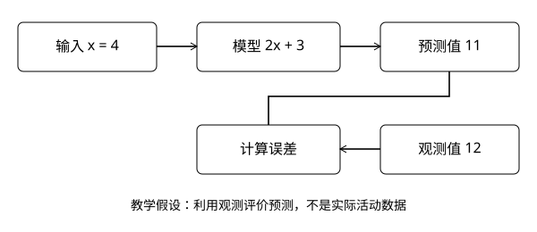

# 为什么计算机能够根据数据作出判断

我们以前编写的报名函数具有明确的规则：人数小于名额才允许报名。每一个判断条件都是开发者事先确定的。

现在考虑另一个任务：根据一段用户留言，判断它主要是在咨询报名时间、活动地点，还是取消报名。

如果要求开发者列出所有可能出现的文字表达，规则可能会非常复杂。不同的人可能用不同语言表达相同意思，也可能在一句话里同时提出多个问题。

我们需要研究另一种建立计算规则的方式。

## 先从一个能够计算的预测开始

假设我们想根据某项活动过去的报名情况，估计它开始宣传后一天会收到多少报名。

为了理解机制，我们先采用一个非常简单的数学关系：

预测报名人数 = a × 宣传次数 + b

其中 a 和 b 是可以改变的数值。如果 a 为 2，b 为 3，宣传 4 次时，预测结果就是 11。

这个关系并不保证能够正确预测实际人数。它只是一种把输入映射到输出的计算方式。

这种用数学关系表示某类现象或任务的计算结构，可以称为模型（Model）。模型中的可调整数值称为参数（Parameter）。

这里的模型并不是一个会理解活动的主体。它接受数值输入，并按照自身结构及参数计算输出。

## 怎样知道参数是否合适

假设我们有三个历史观测：

| 宣传次数 | 实际报名人数 |
|---:|---:|
| 1 | 5 |
| 2 | 7 |
| 3 | 10 |

如果模型给出的预测与实际观测相差很大，我们就可以尝试调整参数，使预测更接近观测。

这种利用数据和相应计算方法建立或调整模型，使模型能够执行某种任务的技术领域，通常称为机器学习（Machine Learning）。

并非所有人工智能都必须使用机器学习，也并非所有模型都通过相同方法得到参数。

## 数据与规则并不是互相排斥的

在普通报名程序中，最大名额 20 是一个明确业务约束，不应该交给模型猜测。

而判断留言主题、估计访问量等任务，可以在适当条件下使用学习得到的模型。

两种方法可以组合：模型提供一个不确定的判断，普通程序按照明确规则决定是否接受它。

人工智能（Artificial Intelligence，AI）涵盖多种让计算机执行通常需要智能能力的任务的方法。机器学习是其中的重要技术方向。

下一章研究计算机怎样根据数据调整模型，以及为什么能够处理训练数据不等于能够正确处理新问题。
