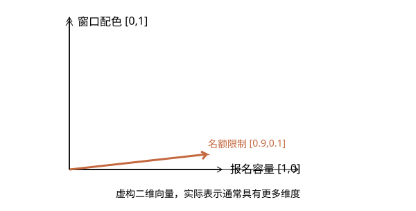

# 怎样找到意思相关、但文字并不完全相同的资料

假设我们的项目文档写着「满员时拒绝新的申请」，而使用者问：「人数达到上限后还能报名吗？」

两段文字没有完全相同的表达，但可能讨论同一项业务规则。

如果只用字符串完全匹配进行搜索，就可能遗漏相关资料。

## 将内容表示为一组数字

第 74 章首次介绍了向量：按照顺序组织的一组数。某些模型可以将文字或其他输入转换为具有特定用途的向量表示。这类表示通常称为嵌入（Embedding）。

例如，我们虚构三个二维向量：

- 报名容量：[1, 0]
- 名额限制：[0.9, 0.1]
- 窗口配色：[0, 1]

它们是为了教学而选取的数字，不是真实模型生成的表示。真实嵌入通常具有更多维度，各维度也不必对应可以单独命名的含义。

## 如何比较两个向量

一种常用方法是余弦相似度（Cosine Similarity）。它利用两个向量的方向关系计算相似程度。

对于两个非零向量 u 和 v，可以将对应位置的乘积相加，再除以两个向量长度的乘积。

下面用 Python 计算教学向量的相似度：

```python
import math

def cosine(u, v):
    dot = sum(a * b for a, b in zip(u, v))
    return dot / (math.hypot(*u) * math.hypot(*v))

query = (1, 0)
capacity = (0.9, 0.1)
appearance = (0, 1)

assert cosine(query, capacity) > cosine(query, appearance)
print(round(cosine(query, capacity), 3))
```

预期输出 0.994。这个函数只用于固定的非零等长教学向量，通用实现需要检查维度及零向量等情况。



## 从相似度到资料检索

我们可以先将文档划分成适当片段，生成每个片段的向量，并保留原文与来源信息。

用户提出问题时，再生成查询向量，查找相似度较高的片段。

提供向量保存与相似查找能力的系统，通常称为向量数据库（Vector Database）或向量检索系统。普通数据库也可能通过扩展提供相应能力，并不是所有项目都需要单独部署一种新数据库。

大量向量的查找可以使用适当索引来减少工作量。某些近似查找方法以一定召回损失换取效率，这与第 44 章索引的设计取舍有关。

## 怎样衡量检索是否找到了需要的材料

假设一个问题有四份已知相关资料，系统返回五份，其中三份确实相关。那么返回结果中的相关比例，即精确率（Precision），为 3/5；已知相关资料中被找到的比例，即召回率（Recall），为 3/4。

这些数字依赖人为或其他可信方式建立的相关性标注。不能仅根据向量分数自行宣布检索正确。

实际系统可以先选取较多候选，再通过重排序（Reranking）调整顺序，并依据访问权限、资料版本和问题范围筛选结果。相似度较高的过期文档不应因此优先于当前有效证据。

## 相似不等于正确

向量相似度不是事实验证。错误版本的文档也可能与问题非常相关。

检索还需要考虑文档权限、版本、关键词精确匹配、来源质量以及结果排序。对于提交标识、错误码和具体函数名，传统关键词搜索可能特别有用。

下一章将研究怎样把检索得到的资料交给语言模型，并检查回答是否真正得到这些资料支持。
