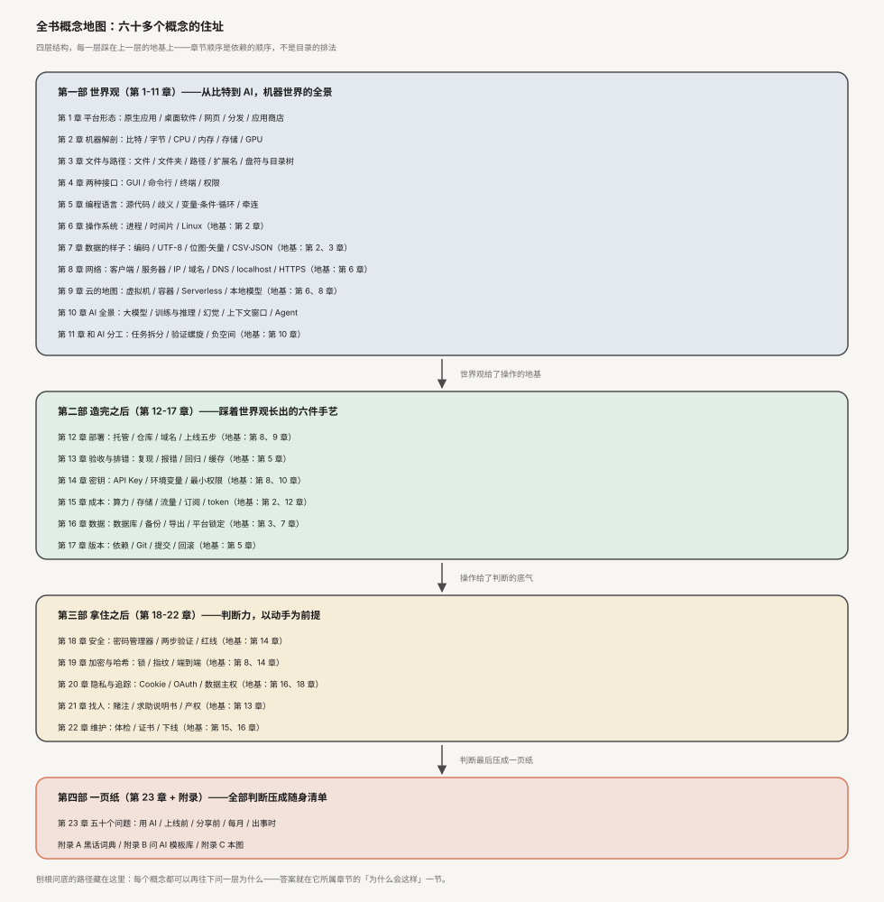

# 附录 C 全书概念地图

> 体系先于细节。这张图是全书的骨架——四十多个概念不是散落的名词，是一座四层建筑的房间号。

## 为什么要有这张图

这本书的知识有一个特性：它们彼此咬合，而不是各自成立。部署解释不了「为什么别人打不开」，除非你先知道程序住在哪；备份的意义，要踩在「数据住在哪里」之上才成立。所以章节的顺序不是目录的排法，是依赖的顺序——这张图把依赖画了出来：第一部是地基，第二部踩着它长出六件手艺，第三部的判断力以动手为前提，第四部把一切压成一页纸。

## 三种用法

开工前看一遍，你的大脑里先装上骨架，后面的每一章都知道自己挂在哪。中途迷路时回来定位：不知道眼前的问题属于哪一层，就在图上找到那间房间。读完之后再回来一次，检验是否成体系——随便指图上一个概念，你能不能说出它为什么住在那一层、它脚下踩着哪块地基。

## 刨根问底的入口

每个概念都可以再往下问一层为什么：为什么程序会牵连、为什么服务认字符不认人、为什么软件永远不会完成。这些「再往下的一层」没有单独成章——它们就藏在每个概念所属章节的「为什么会这样」一节里。图给你住址，章节给你根源；问到不能再问的地方，就是这本书替你打好的地基。

